# Documento de Decisión de Arquitectura - Bank USAC

---

## Índice
- [1. Introducción](#1-introducción)
- [2. Stakeholders y sus preocupaciones](#2-stakeholders-y-sus-preocupaciones)
- [3. Reglas de negocio](#3-reglas-de-negocio)

---

## 1. Introducción
### 1.1 Propósito
Documentar la decisiones de arquitectura y diseño de *Bank USAC*, plataforma basado en microservicios para la gestion bancaria.

### 1.2 Descripción General del Sistema
Bank USAC es una plataforma descentrlizada construida con el objetivo de garantizar soluciones bancarias a clientes, operadores internos y de administracion.
Es un sistema que, por el area al que corresponde, garantiza la disponibilidad, resiliencia y escalabilidad.
Es un producto incremental ya que las necesidades del mismo banco y clientes cambian constantemente, por eso se implementan conceptos de DevOps y SRE.

---

## 2. Stakeholders y sus preocupaciones

### 2.1 Stakeholders

| Stakeholder | Descripción | Preocupaciones | Influencia | 
|---|---|---|---|
|Equipo de IT|Es el equipo encargado del desarrollo del sistema, son las personas tecnicas del equipo que aportan con buenas practicas de programacion y comunicacion asertiva|Poder entregar un MVP concreto, seguro, funcional y a tiempo, concurrencia y disponobilidad tambien son concpetos clave que necesita implementar|Alta|
|Banco|Es la entidad que quiere implementar el sistema para agilizar operaciones redundantes y brindar un servicio moderno a los clientes, este sistema aportara agilidad, velocidad a cada transaccion que quiera realizar el cliente, este entidad es la que financia el proyecto|Tiempos de entrega, aceptacion de los cliente, integridad con sistemas legacy, presupuesto.|Alta|
|Cliente|Representa al cuentahabiente registrado en el sistema, el sistema le permitira generar transacciones y pagos, esto impacatara en la productividad y permitira que nuevos clientes pueda integrar este sistema en su dia a dia|Seguridad de sus datos, seguridad en las transacciones y pagos, disponibilidad alta, evitar fraudes y evitar robos|Alta|
|Cajero Receptor|Este es un operador del banco con responsabilidades en operaciones y transacciones|Disponibilidad, usabilidad, velocidad y recuperacion ante fallos|Alta|
|Administrador de operaciones|Este es encargado de monitorear el sistema, tomar decisiones segun las estadisticas que se obtienen por inferencia, administrar clientes, cuentas y realizar auditoria|Concurrencia, respaldos de seguridad, recuperacion ante fallos, escalabilidad |Alta|
|Administrador del banco|Se encarga de las actividades diarias del banco|Disponibilidad y recuperacion ante fallos|Media|
|Sistema bancario externo|Sistemas bancarios externos que dispongan de una interfaz de comunicacion para realizar transacciones interbancarias|Seguridad de informacion y datos, disponibilidad y creacion del contrato de comunicacion|Media|
|Sistema de correo| Nos permite enviar notificaicones, enlaces de activacion de cuentas a los clientes| Integracion | Baja |

---

## 3. Reglas de negocio
| ID    | Regla                                                                                    |
| ----- | ---------------------------------------------------------------------------------------- |
| RN-01 | El documento y el correo deben ser únicos                                                |
| RN-02 | El username debe ser único                                                               |
| RN-03 | Solo un usuario activo puede recibir un JWT operativo                                    |
| RN-04 | El enlace de activación debe expirar y utilizarse una sola vez                           |
| RN-05 | Una cuenta pertenece exclusivamente a un cliente                                         |
| RN-06 | Una cuenta debe ser monetaria o de ahorro                                                |
| RN-07 | Una cuenta bloqueada o inactiva no puede originar transferencias                         |
| RN-08 | El monto de una operación debe ser mayor que cero                                        |
| RN-09 | Una cuenta no puede transferirse dinero a sí misma                                       |
| RN-10 | El saldo disponible debe cubrir el monto solicitado                                      |
| RN-11 | Los fondos reservados no forman parte del saldo disponible                               |
| RN-12 | Una solicitud repetida con la misma clave de idempotencia no debe generar otra operación |
| RN-13 | Una transferencia solo queda completada cuando todos sus pasos obligatorios finalizan    |
| RN-14 | Un fallo debe producir una compensación cuando existan fondos reservados                 |
| RN-15 | Los fallos de notificación no revierten transferencias o pagos completados               |
| RN-16 | Una cuenta se desactiva después de seis meses sin actividad y con saldo menor a Q50.00   |
| RN-17 | Toda operación distribuida debe conservar el mismo correlationId                      |
| RN-18 | Ningún microservicio puede consultar la base de datos de otro                            |

---

## 4. Entidades del sistema

El sistema se encuentra dividido en cinco microservicios independientes, cada uno responsable de un dominio específico del negocio.

Las solicitudes provenientes del frontend ingresan al sistema mediante un API Gateway, que funciona como punto único de entrada y dirige las solicitudes hacia el microservicio correspondiente.

La arquitectura está compuesta por los siguientes elementos:

- API Gateway.
- Customer Service.
- Account Service.
- Transaction Service.
- Payment Service.
- Notification & Audit Service.
- Broker de mensajería.
- Una base de datos independiente por microservicio.
- Frontend.
- Clúster local de Kubernetes.

### 4.1 Customer Service

El **Customer Service** es responsable de administrar la información y el ciclo de vida de los clientes de Bank USAC.

Sus principales responsabilidades son:

- Registrar nuevos clientes.
- Almacenar la información personal del cliente.
- Administrar las credenciales necesarias para la autenticación.
- Gestionar el estado del cliente.
- Permitir la consulta y actualización de la información del cliente.
- Publicar eventos relacionados con cambios importantes en el cliente.

El estado de un cliente puede ser:

- `ACTIVE`: el cliente se encuentra habilitado para utilizar el sistema.
- `INACTIVE`: el cliente se encuentra registrado, pero no está habilitado para realizar operaciones.
- `BLOCKED`: el cliente se encuentra bloqueado y no puede realizar operaciones que requieran una cuenta habilitada.

El Customer Service posee su propia base de datos y no accede directamente a la información almacenada por los demás microservicios.

---

### 4.2 Account Service

El **Account Service** es responsable de administrar las cuentas bancarias y sus saldos.

Sus principales responsabilidades son:

- Crear cuentas bancarias asociadas a clientes.
- Consultar información de las cuentas.
- Consultar el saldo disponible.
- Gestionar el estado de las cuentas.
- Realizar operaciones de débito y crédito sobre los saldos.
- Publicar eventos cuando se modifica el estado o saldo de una cuenta.
- Participar en operaciones distribuidas como las transferencias bancarias.

El Account Service es el responsable de modificar el saldo de las cuentas. Otros microservicios no modifican directamente esta información.

Cada cuenta pertenece a un cliente identificado mediante su identificador correspondiente.

El Account Service posee su propia base de datos independiente.

---

### 4.3 Transaction Service

El **Transaction Service** es responsable de administrar las transferencias y transacciones realizadas dentro del sistema.

Sus principales responsabilidades son:

- Crear una transacción.
- Registrar la cuenta origen y la cuenta destino.
- Registrar el monto de la operación.
- Mantener el estado de la transacción.
- Coordinar el flujo necesario para completar una transferencia.
- Detectar fallos durante el procesamiento de una transacción.
- Iniciar las acciones de compensación cuando una operación no puede completarse.
- Mantener la relación de los eventos pertenecientes a una misma operación mediante un `correlationId`.

Una transacción puede pasar por los siguientes estados:

- `REQUESTED`: la transacción fue solicitada.
- `PENDING`: la transacción está siendo procesada.
- `COMPLETED`: la transacción finalizó correctamente.
- `FAILED`: ocurrió un error durante la transacción.
- `COMPENSATING`: se están ejecutando acciones para revertir una operación previamente realizada.
- `COMPENSATED`: las operaciones necesarias fueron revertidas correctamente.

El Transaction Service participa en el patrón Saga utilizado para mantener consistencia durante las transferencias bancarias.

El Transaction Service posee su propia base de datos independiente.

---

### 4.4 Payment Service

El **Payment Service** es responsable de gestionar los pagos realizados mediante Bank USAC.

Sus principales responsabilidades son:

- Registrar solicitudes de pago.
- Procesar pagos.
- Mantener el estado de cada pago.
- Registrar el resultado de la operación.
- Publicar eventos relacionados con pagos aprobados, rechazados o fallidos.

Un pago puede pasar por los siguientes estados:

- `PENDING`: el pago fue registrado y está pendiente de procesamiento.
- `PROCESSING`: el pago se encuentra en proceso.
- `APPROVED`: el pago fue procesado correctamente.
- `REJECTED`: el pago fue rechazado por una condición del negocio.
- `FAILED`: el pago no pudo completarse debido a un error durante el procesamiento.

El Payment Service posee su propia base de datos independiente.

---

### 4.5 Notification & Audit Service

El **Notification & Audit Service** es responsable de generar notificaciones y mantener información de auditoría sobre las operaciones importantes realizadas dentro del sistema.

Este servicio funciona principalmente como consumidor de eventos generados por los demás microservicios.

Sus principales responsabilidades son:

- Consumir eventos relevantes del sistema.
- Generar notificaciones para los clientes.
- Registrar operaciones importantes para auditoría.
- Mantener información que permita conocer qué operaciones ocurrieron dentro del sistema.
- Registrar información relacionada con las transacciones y eventos procesados.

Este servicio no necesita ser invocado directamente por otros microservicios para registrar cada operación. En su lugar, recibe los eventos publicados mediante el broker de mensajería.

El Notification & Audit Service posee su propia base de datos independiente.

---

### 4.6 API Gateway

El **API Gateway** funciona como punto único de entrada para las solicitudes provenientes del frontend.

Sus principales responsabilidades son:

- Recibir las solicitudes del cliente.
- Exponer las rutas necesarias del sistema.
- Dirigir cada solicitud hacia el microservicio correspondiente.
- Evitar que el frontend tenga que conocer directamente las direcciones internas de cada microservicio.

El API Gateway solamente participa en las comunicaciones iniciadas desde el exterior del sistema.

La comunicación interna entre microservicios no pasa por el API Gateway.

---

### 4.7 Broker de mensajería

El **broker de mensajería** permite realizar la comunicación asíncrona entre los microservicios.

Los servicios pueden publicar eventos cuando ocurre un cambio importante y otros servicios pueden consumir dichos eventos sin establecer una comunicación directa entre ellos.

El broker permite mantener un bajo acoplamiento entre los microservicios y soportar el modelo de arquitectura orientada a eventos utilizado por Bank USAC.

Cada evento contiene la información necesaria para identificar la operación que lo originó. Para relacionar los diferentes eventos pertenecientes a una misma operación se utiliza un `correlationId`.


---

## 5. Casos de uso de alto nivel
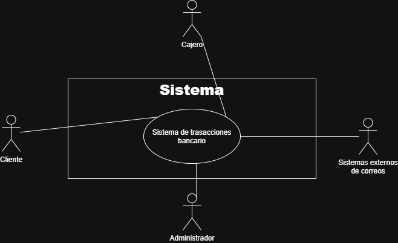


---

### 5.1 Descomposición de Casos de Uso

#### 5.1.1 Costumer Services
- **CDU001:** Gestion de usuarios del sistema

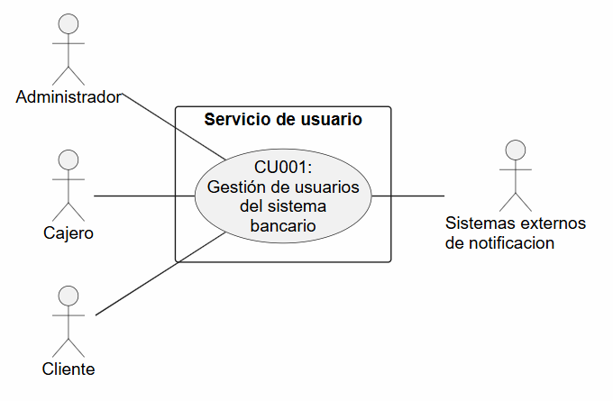

- CDU001.1: Registrar clientes
- CDU001.2: Validar identidad
- CDU001.3: Registrar cajero/receptor
- CDU001.4: Iniciar sesion
- CDU001.5: Activar cuenta
- CDU001.6: Envio de correo de activacion
- CDU001.7: Editar perfil


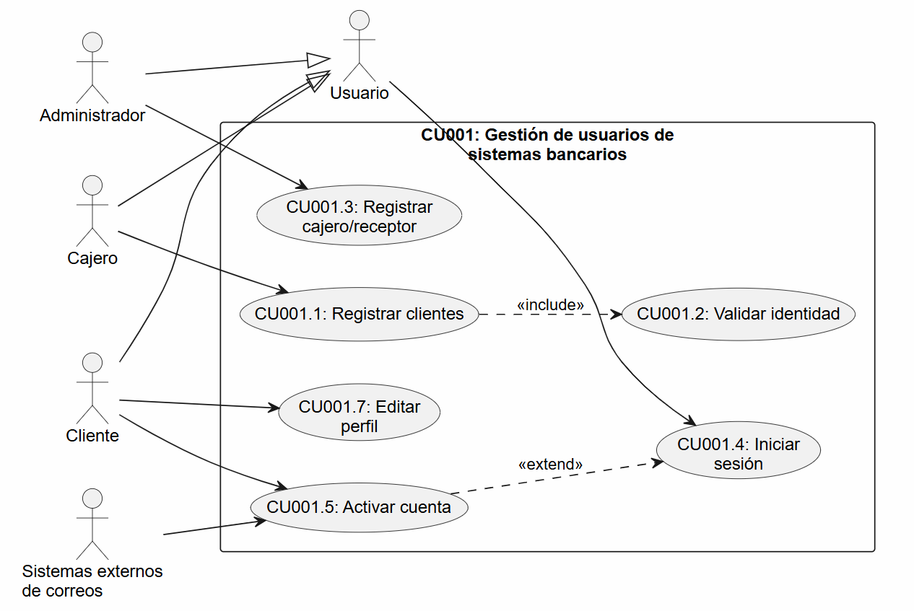


---

#### 5.1.2 Account Services
- **CDU002:** Gestion de cuentas bancarias y saldo

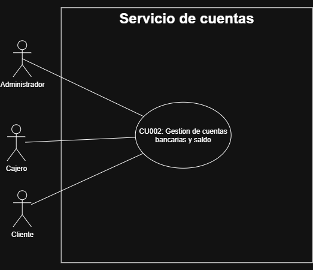

- CDU002.1: Crear cuenta
- CDU002.2: Consultar saldo
- CDU002.3: Consultar cuenta
- CDU002.4: Bloquear cuenta
- CDU002.5: Actualizar saldo
- CDU002.6: Coordinar compensaciones

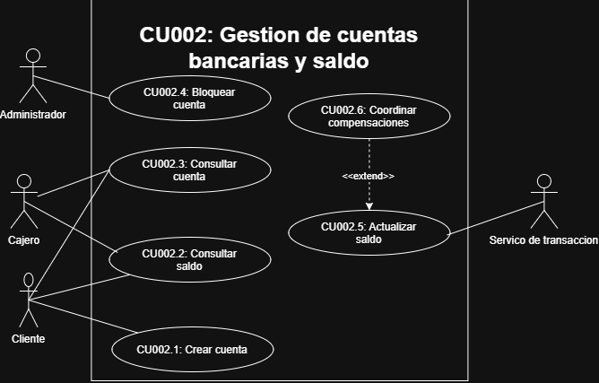

---
#### 5.1.3 Transaction Services
- **CDU003:** Gestion de transacciones monetarias entre cuentas

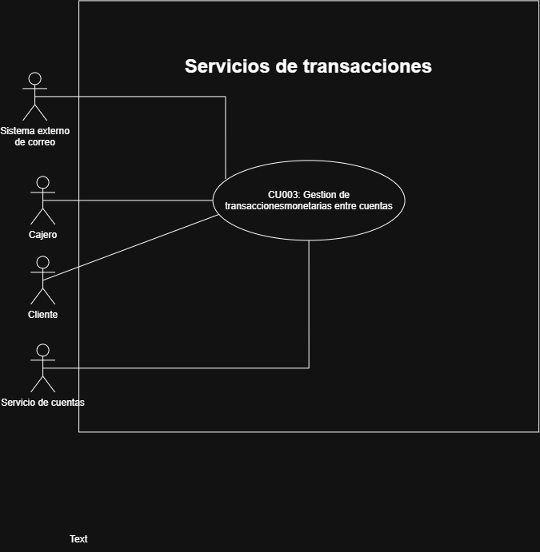


- CDU003.1: Iniciar una transaccion
- CDU003.2: Validacion de informacion
- CDU003.3: Gestion de estado de la transaccion
- CDU003.4: Consultar transacciones

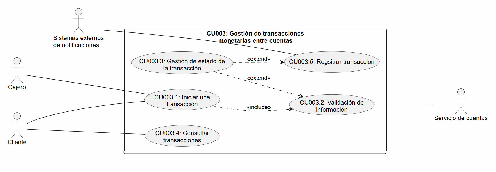

---
#### 5.1.3 Payment Services
- **CDU004:** Gestion de pagos

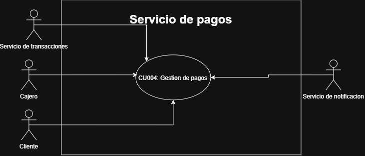

- CDU004.1: Consultar historial de pagos
- CDU004.2: Iniciar pago
- CDU004.3: Validar informacion de pago
- CDU004.4: Registrar pago
- CDU004.5: Cancelar pago

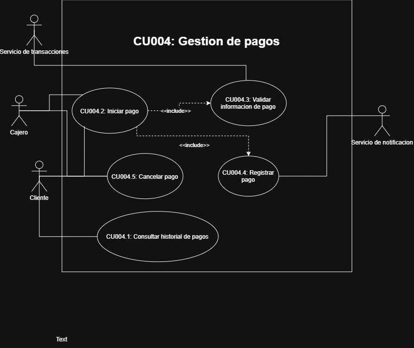

----
#### 5.1.3 Notification & audit service

- **CDU005:** Servicio de notificaciones

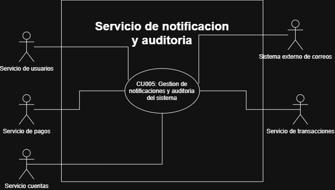

- CDU005.1: Envio de correo de activacion
- CDU005.2: Envio de eventos de operaciones por correo
- CDU005.3: Registrar logs internos del sistema

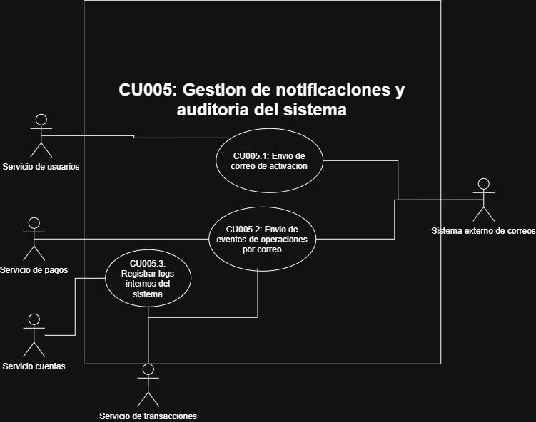

---

## 6. Requisitos funcionales
### 6.1 Customer
| ID        | Requisito                                                                                                            |
| --------- | -------------------------------------------------------------------------------------------------------------------- |
| RF-CUS-01 | Registrar clientes con nombre completo, documento, correo, fecha de nacimiento, dirección y fotografía del documento |
| RF-CUS-02 | Validar que la fecha de nacimiento sea coherente y no se encuentre en el futuro                                      |
| RF-CUS-03 | Evitar documentos y correos duplicados                                                                               |
| RF-CUS-04 | Generar automáticamente un username único a partir del nombre                                                        |
| RF-CUS-05 | Mantener al cliente como pendiente hasta completar su activación                                                     |
| RF-CUS-06 | Enviar el enlace de activación después del primer intento válido de login                                            |
| RF-CUS-07 | Activar al cliente mediante un token temporal de un solo uso                                                         |
| RF-CUS-08 | Autenticar usuarios y emitir JWT                                                                                     |
| RF-CUS-09 | Manejar los roles `ADMIN`, `CASHIER` y `CLIENT`                                                                      |
| RF-CUS-10 | Permitir al cliente actualizar sus datos personales                                                                  |
| RF-CUS-11 | Permitir bloquear o desactivar un cliente                                                                            |
| RF-CUS-12 | Registrar los intentos importantes de autenticación para auditoría                                                   |

### 6.2 Account
| ID        | Requisito                                                               |
| --------- | ----------------------------------------------------------------------- |
| RF-ACC-01 | Crear cuentas monetarias y de ahorro                                    |
| RF-ACC-02 | Asociar cada cuenta con un cliente existente mediante su customerId  |
| RF-ACC-03 | Permitir que un cliente tenga varias cuentas                            |
| RF-ACC-04 | Consultar el saldo de una cuenta                                        |
| RF-ACC-05 | Consultar las cuentas pertenecientes al cliente autenticado             |
| RF-ACC-06 | Administrar los estados `ACTIVE`, `INACTIVE` y `BLOCKED`                |
| RF-ACC-07 | Registrar la fecha de la última actividad financiera                    |
| RF-ACC-08 | Desactivar cuentas con seis meses de inactividad y saldo menor a Q50.00 |
| RF-ACC-09 | Reservar fondos durante una transferencia                               |
| RF-ACC-10 | Confirmar o liberar fondos reservados                                   |
| RF-ACC-11 | Registrar depósitos realizados por un cajero receptor                   |

### 6.3 Transaction
| ID        | Requisito                                                          |
| --------- | ------------------------------------------------------------------ |
| RF-TRA-01 | Crear una solicitud de transferencia entre dos cuentas             |
| RF-TRA-02 | Validar que la cuenta origen sea propiedad del cliente autenticado |
| RF-TRA-03 | Evitar transferencias entre la misma cuenta                        |
| RF-TRA-04 | Rechazar cantidades iguales o menores que cero                     |
| RF-TRA-05 | Mantener el estado de la transferencia                             |
| RF-TRA-06 | Consultar el estado de una transferencia                           |
| RF-TRA-07 | Consultar el historial de transferencias del cliente               |
| RF-TRA-08 | Evitar el procesamiento duplicado de una misma solicitud           |
| RF-TRA-09 | Marcar como fallida una transferencia que no pueda completarse     |
| RF-TRA-10 | Registrar las compensaciones realizadas                            |

### 6.4 Payment
| ID        | Requisito                                   |
| --------- | ------------------------------------------- |
| RF-PAY-01 | Crear un pago asociado a una transacción    |
| RF-PAY-02 | Procesar pagos internos                     |
| RF-PAY-03 | Simular la validación de un sistema externo |
| RF-PAY-04 | Aprobar o rechazar el pago                  |
| RF-PAY-05 | Evitar procesar dos veces el mismo pago     |
| RF-PAY-06 | Registrar la causa de un rechazo            |
| RF-PAY-07 | Permitir consultar el estado del pago       |

### 6.5 Notification & Audit
| ID        | Requisito                                                                         |
| --------- | --------------------------------------------------------------------------------- |
| RF-NOT-01 | Enviar correos de activación                                                      |
| RF-NOT-02 | Notificar transferencias exitosas o fallidas                                      |
| RF-NOT-03 | Notificar pagos aprobados o rechazados                                            |
| RF-NOT-04 | Registrar eventos importantes del sistema                                         |
| RF-NOT-05 | Guardar el tipo de evento, fecha, payload y correlationId                       |
| RF-NOT-06 | Evitar registros de auditoría duplicados                                          |
| RF-NOT-07 | Permitir al administrador consultar auditorías                                    |
| RF-NOT-08 | Reintentar notificaciones fallidas sin revertir operaciones bancarias completadas |

## 7. Requisitos no funcionales y arquitectonicos
| ID     | Requisito                                                          |
| ------ | ------------------------------------------------------------------ |
| RNF-01 | Implementar exactamente cinco microservicios                       |
| RNF-02 | Cada microservicio debe poseer su propia base de datos             |
| RNF-03 | Ningún servicio puede acceder a la base de datos de otro           |
| RNF-04 | Toda comunicación entre microservicios debe ser asíncrona          |
| RNF-05 | El API Gateway debe ser el único punto de entrada                  |
| RNF-06 | El Gateway no debe contener lógica de negocio ni coordinar la Saga |
| RNF-07 | Todos los mensajes deben utilizar `correlationId`                  |
| RNF-08 | Los consumidores deben ser idempotentes                            |
| RNF-09 | Deben existir reintentos y manejo de mensajes fallidos             |
| RNF-10 | El sistema debe tolerar consistencia eventual                      |
| RNF-11 | Todos los componentes deben estar contenerizados                   |
| RNF-12 | Los servicios deben desplegarse en Kubernetes local                |
| RNF-13 | Las bases de datos deben estar fuera del clúster                   |
| RNF-14 | El repositorio debe utilizar una estrategia monorepo               |
| RNF-15 | Deben definirse SLI, SLO y SLA                                     |
| RNF-16 | La implementación y los diagramas deben ser consistentes           |

---

## 8. Diagrama de contexto

El presente diagrama de contexto representa el sistema **Bank Usac** como una única entidad central que interactúa con diferentes actores externos.

El objetivo es mostrar de manera clara los límites del sistema y los flujos de información que intercambia con su entorno, sin detallar procesos internos ni bases de datos.

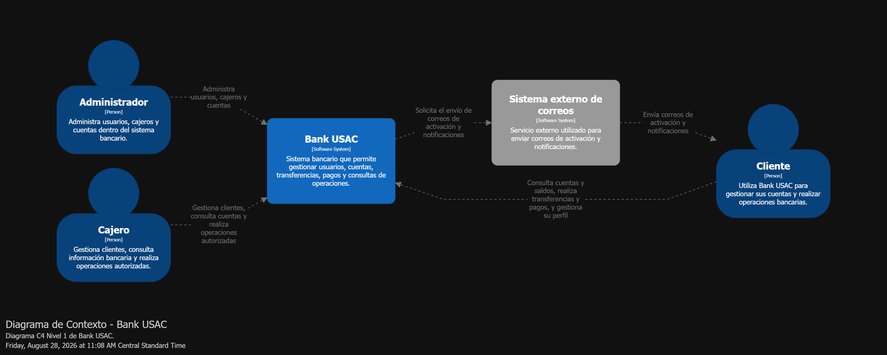

---

## 9. Definicion de tecnologias
La selección tecnológica de Bank USAC se realiza considerando las características particulares del sistema: arquitectura de microservicios, operaciones financieras, comunicación asíncrona, consistencia eventual, resiliencia, trazabilidad y despliegue mediante Kubernetes.

### 9.1 Resumen de tecnologías seleccionadas
| Componente               | Tecnología seleccionada  |
| ------------------------ | ------------------------ |
| Lenguaje backend         | TypeScript               |
| Runtime backend          | Node.js                  |
| Framework backend        | Express                  |
| Frontend                 | React + TypeScript       |
| API Gateway              | Node.js + Express        |
| Broker de mensajería     | RabbitMQ                 |
| Base de datos            | PostgreSQL               |
| ORM                      | Prisma                   |
| Autenticación            | JWT                      |
| Contenedores             | Docker                   |
| Orquestación             | Kubernetes               |
| Entrada al clúster       | NGINX Ingress Controller |
| Métricas                 | Prometheus               |
| Visualización            | Grafana                  |
| Logs                     | Logs estructurados JSON  |
| Trazabilidad funcional   | `correlationId`          |
| Gestión de configuración | ConfigMap + Secret       |
| Control de versiones     | Git                      |
| Organización repositorio | Monorepo                 |

### 9.2 Lenguaje y runtime de backend
| Característica               | Node.js + TypeScript    | Java + Spring Boot | Python + FastAPI |
| ---------------------------- | ----------------------- | ------------------ | ---------------- |
| Tipado estático              | Sí, mediante TypeScript | Sí                 | Parcial          |
| Facilidad para APIs          | Alta                    | Alta               | Muy alta         |
| Curva de aprendizaje         | Media                   | Alta               | Baja             |
| Ecosistema empresarial       | Alto                    | Muy alto           | Alto             |
| Arquitecturas grandes        | Bueno                   | Excelente          | Bueno            |
| Desarrollo rápido            | Alto                    | Medio              | Muy alto         |
| Compartir tipos con frontend | Sí                      | No directamente    | No directamente  |

La mayoría de las operaciones de Bank USAC corresponden a:

- acceso a bases de datos;
- llamadas al broker;
- procesamiento de solicitudes HTTP;
- serialización de eventos;
- envío de notificaciones.

Son operaciones principalmente de entrada/salida, para las cuales el modelo asíncrono de Node.js funciona adecuadamente.

**Ventajas:**

- desarrollo rápido
- ecosistema amplio
- buen soporte asíncrono
- tipado mediante TypeScript
- una misma tecnología para Gateway y microservicios
- menor diversidad tecnológica

**Desventajas:**

- Node.js no es ideal para tareas intensivas de CPU
- el tipado de TypeScript desaparece en runtime
- requiere validación adicional de entradas
- Spring Boot ofrece herramientas empresariales más maduras

### 9.3 Framework backend
| Característica                      | Express  | NestJS     | Fastify   |
| ----------------------------------- | -------- | ---------- | --------- |
| Simplicidad                         | Muy alta | Media      | Alta      |
| Curva de aprendizaje                | Baja     | Media/Alta | Baja      |
| Arquitectura incorporada            | Baja     | Muy alta   | Baja      |
| Rendimiento                         | Bueno    | Bueno      | Muy bueno |
| Flexibilidad                        | Muy alta | Alta       | Alta      |
| Boilerplate                         | Bajo     | Alto       | Bajo      |
| Inyección de dependencias integrada | No       | Sí         | No        |

Express proporciona libertad, pero esa libertad también implica que el equipo debe establecer arquitectura limpia.

Con NestJS parte de esa estructura estaría integrada en el framework, pero se introduciría más abstracción y dependencia del framework.

### 9.4 Frontend
| Característica       | React     | Angular | Vue       |
| -------------------- | --------- | ------- | --------- |
| Curva de aprendizaje | Media     | Alta    | Baja      |
| Flexibilidad         | Muy alta  | Media   | Alta      |
| Ecosistema           | Muy alto  | Alto    | Alto      |
| Estructura impuesta  | Baja      | Alta    | Media     |
| TypeScript           | Excelente | Nativo  | Excelente |
| Complejidad inicial  | Baja      | Alta    | Baja      |

React permite desarrollar rápidamente la interfaz, pero impone menos decisiones arquitectónicas que Angular.

**Decision final:** React + Typescript

### 9.5 Broker de mensajería
| Característica          | RabbitMQ             | Kafka                     | NATS JetStream |
| ----------------------- | -------------------- | ------------------------- | -------------- |
| Modelo principal        | Message broker       | Event streaming           | Messaging      |
| Colas tradicionales     | Excelente            | No es su modelo principal | Sí             |
| Routing                 | Excelente            | Limitado por topics       | Bueno          |
| Replay histórico        | Limitado             | Excelente                 | Sí             |
| Alto throughput         | Alto                 | Muy alto                  | Muy alto       |
| DLQ                     | Fácil de implementar | Requiere diseño           | Posible        |
| Complejidad operacional | Media                | Alta                      | Baja/Media     |
| Adecuado para comandos  | Excelente            | Bueno                     | Excelente      |
| Event sourcing          | Limitado             | Excelente                 | Bueno          |
| Ecosistema              | Muy maduro           | Muy maduro                | Maduro         |

Bank USAC necesita principalmente:
Evento/comando
        ↓
cola
        ↓
consumidor
        ↓
ACK / retry / DLQ

**RabbitMQ**
+ routing flexible
+ acknowledgements
+ DLQ
+ retries
+ apropiado para workflows
+ menor complejidad que Kafka

- replay histórico limitado
- menor throughput extremo
- broker se convierte en infraestructura crítica

**Kafka**
+ throughput enorme
+ persistencia del log
+ replay
+ excelente para event streaming

- mayor complejidad
- más infraestructura
- innecesario para nuestro volumen esperado

Se acepta perder parte de las capacidades de replay de Kafka a cambio de una solución más sencilla para los patrones de mensajería requeridos.

### 9.6 Base de datos
| Característica         | PostgreSQL | MySQL      | MongoDB                  |
| ---------------------- | ---------- | ---------- | ------------------------ |
| Modelo                 | Relacional | Relacional | Documental               |
| Transacciones ACID     | Excelente  | Excelente  | Sí                       |
| Constraints            | Excelente  | Excelente  | Diferentes               |
| Relaciones             | Excelente  | Excelente  | No es su fortaleza       |
| JSON                   | Excelente  | Bueno      | Excelente                |
| Datos financieros      | Excelente  | Excelente  | Posible                  |
| Integridad referencial | Muy alta   | Muy alta   | Gestionada de otra forma |
| SQL                    | Sí         | Sí         | No                       |

**PostgreSQL**
+ ACID
+ integridad
+ relaciones
+ constraints
+ consultas complejas

- escalado horizontal más complejo
- estructura más rígida que MongoDB

Para datos financieros se prioriza la consistencia y la integridad sobre la flexibilidad del esquema.

---

## 10. Comunicación asíncrona
La comunicación entre microservicios de Bank USAC será 100 % asíncrona mediante RabbitMQ.

El API Gateway no será utilizado como canal para comunicación entre microservicios.

### 10.1 Tipo de mensajes
- Comandos: representan una solicitud para realizar una acción.
- Eventos: representan hechos que ya ocurrieron.

### 10.2 Mensaje estandar
```
{
  "eventId": "21a86372-...",
  "eventType": "FundsReserved",
  "eventVersion": 1,
  "occurredAt": "2026-08-28T15:45:00Z",
  "correlationId": "4207d601-...",
  "causationId": "feeb12d7-...",
  "producer": "account-service",
  "payload": {}
}


```

### 10.3 Retry

**Error transitorio**

Ejemplos:

- conexión temporalmente caída
- timeout
- SMTP no disponible

**Politica de intentos**
- 3 intentos (5 seg, 15 seg, 30 seg) -> DLQ

### 10.4 Dead Letter Queue

Los mensajes no deberán eliminarse inmediatamente.

Se conservarán para:

- diagnóstico;
- auditoría;
- corrección;
- reprocesamiento.

---

## 11. Catalogo de eventos

### 11.1 Costumer Service
| Mensaje                    | Tipo   | Productor | Consumidor                    |
| -------------------------- | ------ | --------- | ----------------------------- |
| `CustomerRegistered`       | Evento | Customer  | Notification & Audit          |
| `CustomerActivated`        | Evento | Customer  | Notification & Audit          |
| `CustomerUpdated`          | Evento | Customer  | Notification & Audit          |
| `CustomerBlocked`          | Evento | Customer  | Account, Notification & Audit |
| `ActivationEmailRequested` | Evento | Customer  | Notification & Audit          |
| `AuthenticationFailed`     | Evento | Customer  | Notification & Audit          |

### 11.2 Acount service
| Mensaje                     | Tipo    | Productor   | Consumidor                         |
| --------------------------- | ------- | ----------- | ---------------------------------- |
| `AccountCreated`            | Evento  | Account     | Notification & Audit               |
| `AccountBlocked`            | Evento  | Account     | Transaction, Payment, Notification |
| `BalanceUpdated`            | Evento  | Account     | Notification & Audit               |
| `ReserveFunds`              | Comando | Transaction | Account                            |
| `FundsReserved`             | Evento  | Account     | Transaction                        |
| `FundsReservationRejected`  | Evento  | Account     | Transaction                        |
| `CreditDestination`         | Comando | Transaction | Account                            |
| `DestinationCredited`       | Evento  | Account     | Transaction                        |
| `DestinationCreditRejected` | Evento  | Account     | Transaction                        |
| `ConfirmDebit`              | Comando | Transaction | Account                            |
| `DebitConfirmed`            | Evento  | Account     | Transaction                        |
| `DebitConfirmationFailed`   | Evento  | Account     | Transaction                        |
| `ReleaseFunds`              | Comando | Transaction | Account                            |
| `FundsReleased`             | Evento  | Account     | Transaction                        |
| `ReverseDestinationCredit`  | Comando | Transaction | Account                            |
| `DestinationCreditReversed` | Evento  | Account     | Transaction                        |

### 11.3 Transaction Service
| Mensaje                       | Tipo   | Productor   | Consumidor           |
| ----------------------------- | ------ | ----------- | -------------------- |
| `TransferRequested`           | Evento | Transaction | Notification & Audit |
| `TransferProcessing`          | Evento | Transaction | Notification & Audit |
| `TransferCompleted`           | Evento | Transaction | Notification & Audit |
| `TransferFailed`              | Evento | Transaction | Notification & Audit |
| `TransferCompensationStarted` | Evento | Transaction | Notification & Audit |
| `TransferCompensated`         | Evento | Transaction | Notification & Audit |

### 11.4 Payment service
| Mensaje                        | Tipo   | Productor | Consumidor           |
| ------------------------------ | ------ | --------- | -------------------- |
| `PaymentRequested`             | Evento | Payment   | Notification & Audit |
| `PaymentProcessing`            | Evento | Payment   | Notification & Audit |
| `PaymentApproved`              | Evento | Payment   | Notification & Audit |
| `PaymentRejected`              | Evento | Payment   | Notification & Audit |
| `PaymentFailed`                | Evento | Payment   | Notification & Audit |
| `PaymentCancellationRequested` | Evento | Payment   | Notification & Audit |
| `PaymentCancelled`             | Evento | Payment   | Notification & Audit |

### 11.5 Notification & Audit Service
| Evento               | Productor    | Propósito            |
| -------------------- | ------------ | -------------------- |
| `NotificationSent`   | Notification | Notificación enviada |
| `NotificationFailed` | Notification | Notificación fallida |
| `AuditRecorded`      | Notification | Evento auditado      |

---

## 12. Service level Indicators

### 12.1 Disponibilidad


```
solicitudes válidas atendidas
───────────────────────────── × 100
solicitudes válidas totales
```


### 12.2 Tasa de errores
```
errores 5xx
─────────── × 100
requests
```

### 12.3 Transferencias procesadas correctamente

```
transferencias COMPLETED
──────────────────────── × 100
transferencias aceptadas
```

### 12.4 Tiempo de procesamiento de eventos
```
consumedAt - occurredAt
```

---

## 13. Service Level Objective

| SLI                                       |              SLO |
| ----------------------------------------- | ---------------: |
| Disponibilidad del API                    | ≥ 99.5 % mensual |
| Requests de lectura P95                   |         < 500 ms |
| Creación de operación P95                 |            < 1 s |
| Operaciones financieras sin error técnico |           ≥ 99 % |
| Eventos procesados antes de 5 s           |           ≥ 99 % |
| Mensajes enviados a DLQ                   |          < 0.5 % |
| Notificaciones procesadas antes de 30 s   |           ≥ 95 % |

---

## 14. Service Level Agreement

Bank USAC establece una disponibilidad mensual mínima del 99 % para las funcionalidades principales expuestas mediante el API Gateway, excluyendo periodos de mantenimiento planificado y fallos atribuibles exclusivamente a proveedores externos.

---

## 15. Diagrama de secuencia

### 15.1 Creacion cuenta
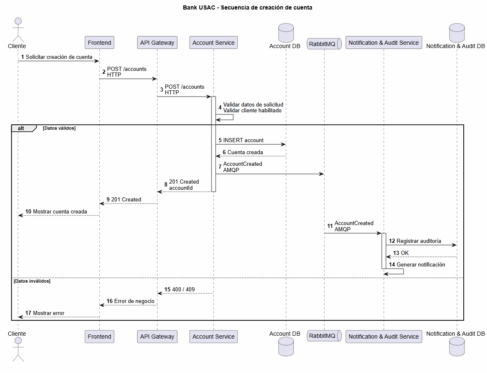

### 15.2 Transferencia exitosa
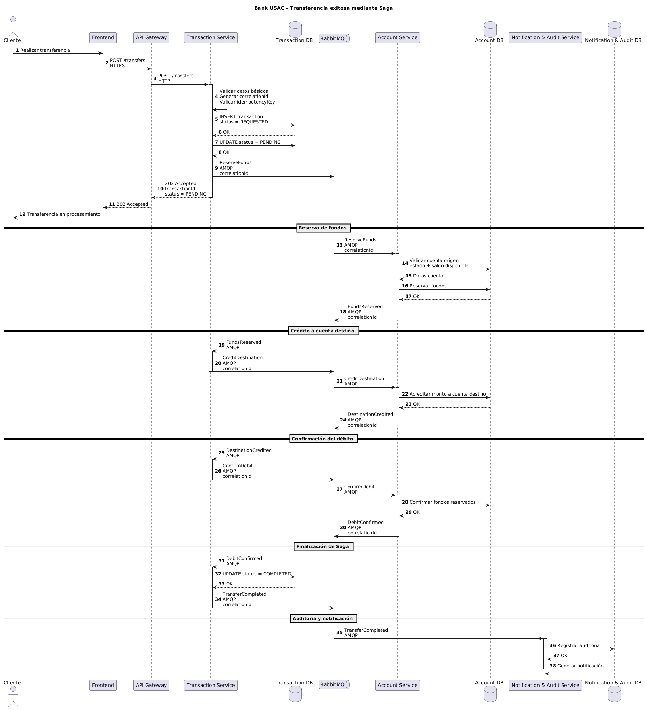

---

## 16. Diagrama de Contenedores
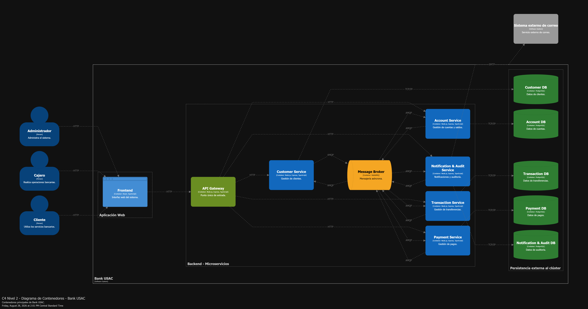


## Diagrama de Arquitectura

El siguiente diagrama representa la arquitectura general del sistema, mostrando la interacción entre la interfaz de usuario, el API Gateway, los microservicios, el sistema de mensajería y las bases de datos.

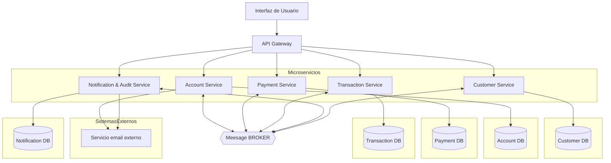