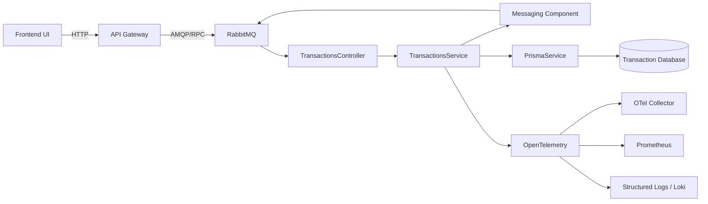

# C4 - Diagrama de componentes

El diagrama muestra la descomposición interna de **Transaction Service** y sus dependencias directas.

En el despliegue cloud, Transaction Service se ejecuta como un Pod dentro de
GKE. RabbitMQ se ejecuta en el mismo clúster y Transaction Database es una base
lógica de PostgreSQL alojada en la VM `bank-usac-db`.

- El Frontend UI consume el API Gateway mediante `HTTP`.

- El API Gateway envía las solicitudes de creación y consulta de transferencias a TransactionsController mediante `AMQP`.
- TransactionsController recibe los comandos `create_transaction`, `get_transaction` y `get_transactions_by_customer`, y delega su procesamiento a **TransactionsService**.
- AccountEventsController recibe los eventos de Account Service: `FundsReserved`, `FundsReservationRejected`, `FundsCommitted` y `FundsReleased`.
- **TransactionsService** crea y consulta transferencias, actualiza sus estados y publica los eventos que representan esos cambios.
- **Messaging Component** representa la comunicación con RabbitMQ. Transaction Service publica `TransactionRequested` y `TransactionProcessing`; Account Service reacciona reservando, confirmando o liberando fondos. Ningún servicio modifica la base de datos de otro.
- **PrismaService** es el único componente que accede a **Transaction Database** para persistir transferencias y eventos ya procesados.
- **OpenTelemetry** instrumenta las solicitudes HTTP y los consumidores RabbitMQ; propaga `traceparent` y exporta trazas al Collector.
- **Observability Metrics** registra throughput, errores, latencias, éxitos, fallos y tiempos de procesamiento de eventos para Prometheus.
- **Structured Logger** emite logs JSON con `correlationId`, `traceId` y `spanId` para su consulta en Loki.

Cada microservicio posee una base de datos propia. Ningún microservicio consulta directamente la base de datos de otro.

