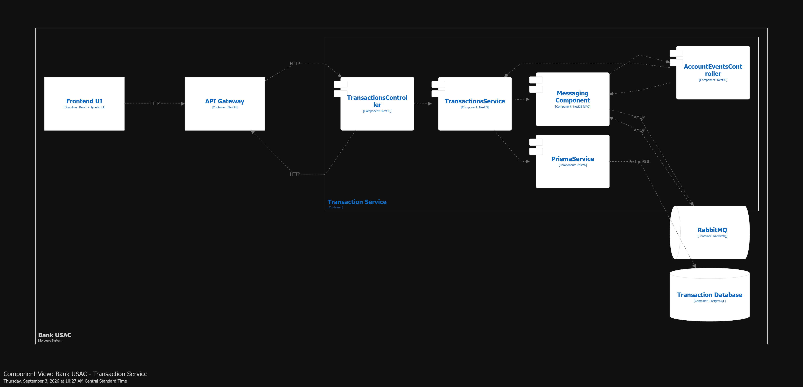

# C4 - Diagrama de componentes

El diagrama muestra la descomposición interna de **Transaction Service** y sus dependencias directas.

- El Frontend UI consume el API Gateway mediante `HTTP`.

- El API Gateway envía las solicitudes de creación y consulta de transferencias a TransactionsController mediante `AMQP`.
- TransactionsController recibe los comandos `create_transaction`, `get_transaction` y `get_transactions_by_customer`, y delega su procesamiento a **TransactionsService**.
- AccountEventsController recibe los eventos de Account Service: `FundsReserved`, `FundsReservationRejected`, `DestinationCredited`, `DestinationCreditRejected` y `FundsReleased`.
- **TransactionsService** crea y consulta transferencias, actualiza sus estados y coordina los comandos de la Saga.
- **Messaging Component** representa la comunicación con RabbitMQ. Publica comandos hacia Account Service y eventos de transferencia para el servicio de notificaciones; también recibe los eventos necesarios para continuar o compensar una transferencia.
- **PrismaService** es el único componente que accede a **Transaction Database** para persistir transferencias y eventos ya procesados.

Cada microservicio posee una base de datos propia. Ningún microservicio consulta directamente la base de datos de otro.
