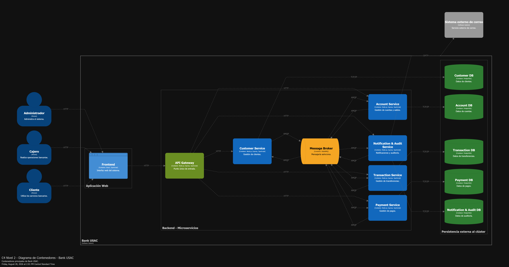

# C4 - Diagrama de contenedores

Bank USAC se compone de una interfaz web, un API Gateway, cinco microservicios, RabbitMQ y una base de datos independiente por microservicio. El Gateway es el único punto de entrada; la comunicación interna se realiza de forma asíncrona mediante el broker.

