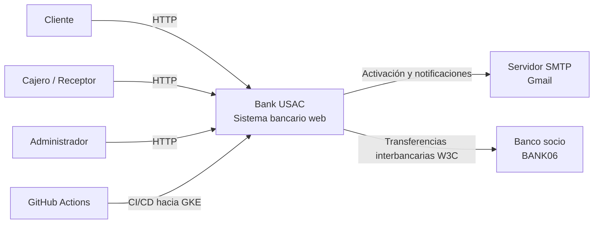

# C4 - Diagrama de contexto cloud

El diagrama de contexto representa **Bank USAC** como un sistema bancario web
desplegado en Google Cloud Platform (GCP). En este nivel el sistema se muestra como una
única unidad; los microservicios, máquinas virtuales y bases de datos se detallan
en los diagramas de contenedores y despliegue.

Los actores humanos son el cliente, el cajero/receptor y el administrador. Los
tres acceden desde un navegador a la dirección pública entregada por Google Cloud Load Balancer (`http://34.29.251.106`). El
sistema también se comunica con un servidor SMTP externo (Gmail) para enviar enlaces
de activación y notificaciones, y con la red interbancaria (Banco Socio BANK06).

| Actor o sistema externo | Interacción con Bank USAC |
| --- | --- |
| Cliente | Consulta cuentas y saldos, realiza transferencias y pagos, y administra su perfil |
| Cajero/Receptor | Registra clientes y cuentas, y ejecuta operaciones asistidas |
| Administrador | Gestiona usuarios, cajeros, cuentas y validaciones KYC |
| Servidor SMTP (Gmail) | Entrega correos de activación y notificaciones generadas por el sistema |
| Banco Socio (BANK06) | Procesa transferencias interbancarias directas con trazabilidad distribuida W3C |
| GitHub Actions | Automatiza la construcción, pruebas y entrega continua hacia GKE mediante Helm 3 y WIF |

El límite de Bank USAC se encuentra dentro de una frontera de nube
**Google Cloud Platform**, indicando que el acceso público entra por Google Cloud Load
Balancer. No deben mostrarse componentes internos en este nivel.

