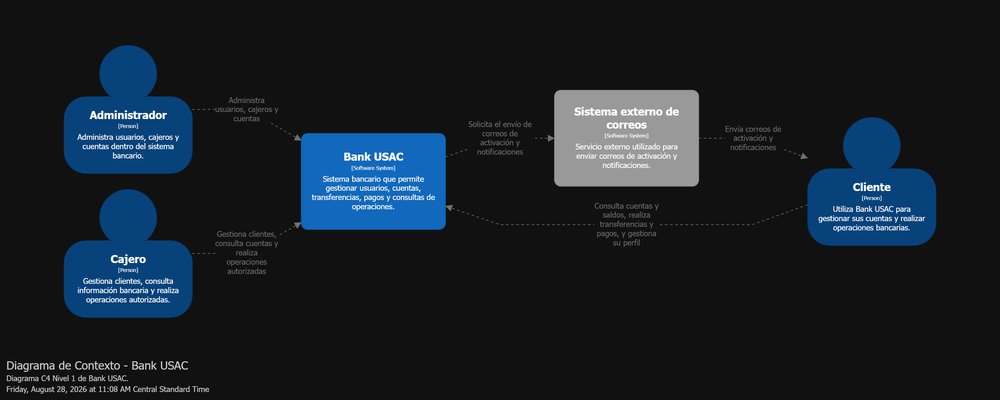

# C4 - Diagrama de contexto cloud

El diagrama de contexto representa **Bank USAC** como un sistema bancario web
desplegado en Microsoft Azure. En este nivel el sistema se muestra como una
única unidad; los microservicios, máquinas virtuales y bases de datos se detallan
en los diagramas de contenedores y despliegue.

Los actores humanos son el cliente, el cajero/receptor y el administrador. Los
tres acceden desde un navegador a la dirección pública entregada por Azure. El
sistema también se comunica con un proveedor SMTP externo para enviar enlaces
de activación y notificaciones.

| Actor o sistema externo | Interacción con Bank USAC |
| --- | --- |
| Cliente | Consulta cuentas y saldos, realiza transferencias y pagos, y administra su perfil |
| Cajero/Receptor | Registra clientes y cuentas, y ejecuta operaciones asistidas |
| Administrador | Gestiona usuarios, cajeros, cuentas y validaciones KYC |
| Proveedor SMTP | Entrega correos de activación y notificaciones generadas por el sistema |
| GitHub Actions | Automatiza la construcción y entrega de nuevas versiones hacia Azure |

El límite de Bank USAC debe dibujarse dentro de una frontera de nube
**Microsoft Azure**, indicando que el acceso público entra por Azure Load
Balancer. No deben mostrarse componentes internos en este nivel.

> La imagen debe regenerarse para sustituir cualquier referencia al despliegue
> local o a proveedores cloud anteriores por Microsoft Azure.
