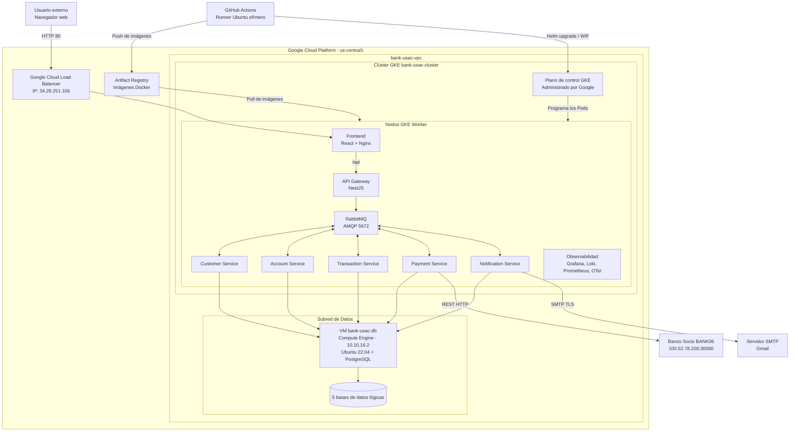

# Despliegue cloud implementado en Google Cloud Platform (GCP)

Bank USAC se despliega en la región **us-central1** (zona `us-central1-a`) de Google Cloud Platform (GCP). La
infraestructura se aprovisiona con Terraform y las aplicaciones se ejecutan
como contenedores dentro de Google Kubernetes Engine (GKE).

## Modelo físico y virtual

El equipo no administra servidores físicos. El hardware físico pertenece a los
centros de datos de GCP y queda fuera del límite operativo del sistema. Para
el diagrama de despliegue se representan los siguientes nodos lógicos y
virtuales:

| Nodo | Tipo | Configuración | Responsabilidad |
| --- | --- | --- | --- |
| Dispositivo del usuario | Equipo externo | Navegador web con acceso a Internet | Acceder a la interfaz de Bank USAC |
| GCP Datacenter | Infraestructura física administrada | Región `us-central1` | Alojar los servicios cloud del proyecto |
| Plano de control de GKE | Servicio administrado | Administrado por Google | Orquestar Kubernetes clúster `bank-usac-cluster` |
| Nodos trabajadores GKE | Máquinas virtuales (Compute Engine) | e2-standard-4 / e2-medium | Ejecutar frontend, API Gateway, microservicios, RabbitMQ y Observabilidad |
| VM de base de datos | Máquina virtual | `bank-usac-db`, Ubuntu Server 22.04 LTS (`10.10.16.2`) | Ejecutar PostgreSQL y las cinco bases de datos lógicas |
| GitHub Actions Runner | VM efímera administrada | `ubuntu-latest` | Compilar, probar, construir imágenes y ejecutar el despliegue continuo vía WIF |

No se dibujan cinco servidores de base de datos. Existe una sola VM con
PostgreSQL y cinco bases lógicas: `db_customer`, `db_account`,
`db_transaction`, `db_payment` y `db_notification`.

## Recursos administrados de Google Cloud Platform (GCP)

Los siguientes elementos forman parte del despliegue:

| Recurso | Configuración | Uso |
| --- | --- | --- |
| GCP Project | `project-de5dd415-1a0b-4df8-8a8` | Agrupa la infraestructura de Bank USAC |
| Virtual Private Cloud | `bank-usac-vpc` | Red privada del sistema con peering/acceso interno |
| Clúster GKE | `bank-usac-cluster` (`us-central1-a`) | Orquestador de contenedores Kubernetes |
| Artifact Registry | `us-central1-docker.pkg.dev/...` | Almacena las imágenes Docker versionadas |
| Cloud Load Balancer | Service `frontend` (`34.29.251.106`) | Expone el puerto 80 del frontend a Internet |
| Compute Engine VM | `bank-usac-db` (`10.10.16.2`) | Servidor dedicado de PostgreSQL aislado en la VPC |
| Reglas de Firewall GCP | `bank-usac-firewall` | Permite PostgreSQL 5432 desde la subred GKE y acceso administrativo SSH |

## Cargas desplegadas en GKE

Todas estas cargas se ejecutan como Pods dentro del clúster de
GKE organizadas por namespace (`dev` y `prod`):

| Carga | Tecnología | Exposición |
| --- | --- | --- |
| Frontend | React compilado y servido por Nginx | Service `LoadBalancer` (IP: `34.29.251.106:80`) |
| API Gateway | NestJS | Service `LoadBalancer` (IP: `34.72.210.212:3000`) y `ClusterIP` 3000 |
| Customer Service | NestJS + Prisma | Red interna de Kubernetes |
| Account Service | NestJS + Prisma | Red interna de Kubernetes |
| Transaction Service | NestJS + Prisma | Red interna de Kubernetes |
| Payment Service | NestJS + Prisma | Red interna de Kubernetes (comunicación interbancaria con BANK06) |
| Notification Service | NestJS + Prisma + Nodemailer | Red interna y conexión saliente SMTP Gmail |
| RabbitMQ | `rabbitmq:3-management` | `ClusterIP`, AMQP 5672 y consola 15672 interna |
| Stack de Observabilidad | Prometheus, Grafana, Loki, Alertmanager, OpenTelemetry | Grafana expuesto en `136.64.164.78:3000` |

El HPA permite escalar API Gateway y los microservicios entre 1 y 5 Pods
cuando el promedio de CPU alcanza el 80%.

## Flujo de red

1. El usuario accede a la IP pública asignada al Service `frontend` (`34.29.251.106`).
2. Google Cloud Load Balancer dirige la solicitud al Pod de Nginx en el puerto 80.
3. Nginx entrega la aplicación React y reenvía las rutas `/api/*` al API Gateway.
4. API Gateway valida la solicitud y se comunica con los microservicios por RabbitMQ y HTTP interno.
5. Cada microservicio se conecta por la VPC de GCP a su base lógica en PostgreSQL (`10.10.16.2`).
6. Notification Service se conecta vía SMTP a Gmail para el envío de correos de activación.
7. Payment Service se conecta vía REST al Banco 06 (`100.52.78.200:30080`) propagando W3C Traceparent.

## Diagrama de despliegue

## Aprovisionamiento y entrega continua

Terraform crea la VPC, subredes, reglas de firewall, Artifact Registry, clúster GKE y la
VM de Compute Engine con PostgreSQL.

Al integrar cambios en `develop`, GitHub Actions compila y prueba el proyecto,
construye las imágenes modificadas, las publica en Artifact Registry y actualiza los
Deployments mediante Helm 3 en el namespace `dev`. El flujo de producción utiliza el namespace
`prod` y realiza rolling updates con imágenes versionadas y tags semánticos.

## Despliegue implementado en Google Cloud Platform (GCP)

El sistema activo y validado opera en **Google Cloud Platform (GCP)** en la región `us-central1` (zona `us-central1-a`):

| Componente | Servicio GCP | Configuración |
| --- | --- | --- |
| **Orquestador** | Google Kubernetes Engine (GKE) | Clúster `bank-usac-cluster` |
| **Registro de Contenedores** | Artifact Registry | Repositorio Docker `us-central1-docker.pkg.dev/project-de5dd415-1a0b-4df8-8a8/bank-usac` |
| **Base de Datos** | Compute Engine VM | Instancia `bank-usac-db` (`10.10.16.2`), Ubuntu 22.04 LTS, PostgreSQL |
| **Red Privada** | Google Cloud VPC | Subredes dedicadas para GKE y para la VM de base de datos |
| **Empaquetado** | Helm 3 | Chart `charts/bank-usac` con plantillas parametrizadas por entorno (`dev` y `prod`) |
| **Observabilidad** | Stack de Observabilidad | Grafana (`136.64.164.78:3000`), Prometheus, Loki, Tempo y OpenTelemetry Collector |
| **Ingress / Acceso Web** | Google Cloud Load Balancer | Frontend expuesto en IP pública `34.29.251.106:80` |

## Evidencia de implementación

- Infraestructura como código GCP: `terraform-gcp/`.
- Infraestructura como código Azure: `terraform/`.
- Helm Charts: `charts/bank-usac/` y `charts/observability/`.
- Manifiestos de Kubernetes: `k8s/infra/` y `k8s/observability/`.
- Autoescalado HPA: `charts/bank-usac/templates/hpa.yaml` y `k8s/infra/hpa/`.
- Pipeline CI Feature: `.github/workflows/ci-feature.yml`.
- Pipeline CI/CD Develop: `.github/workflows/ci-cd-develop.yml`.
- Pipeline Release: `.github/workflows/release.yml`.
- Pipeline CD Producción: `.github/workflows/cd-production.yml`.
- Configuración del proxy web frontend: `frontend/nginx.conf`.
