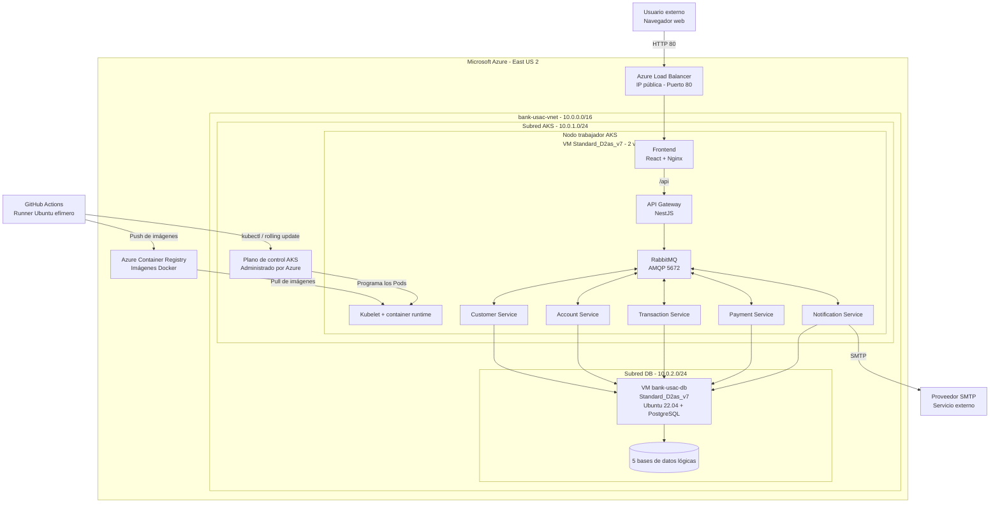

# Despliegue cloud implementado en Azure

Bank USAC se despliega en la región **East US 2** de Microsoft Azure. La
infraestructura se aprovisiona con Terraform y las aplicaciones se ejecutan
como contenedores dentro de Azure Kubernetes Service (AKS).

## Modelo físico y virtual

El equipo no administra servidores físicos. El hardware físico pertenece a los
centros de datos de Azure y queda fuera del límite operativo del sistema. Para
el diagrama de despliegue deben representarse los siguientes nodos lógicos y
virtuales:

| Nodo | Tipo | Configuración | Responsabilidad |
| --- | --- | --- | --- |
| Dispositivo del usuario | Equipo externo | Navegador web con acceso a Internet | Acceder a la interfaz de Bank USAC |
| Azure Datacenter | Infraestructura física administrada | Región `East US 2` | Alojar los servicios cloud del proyecto |
| Plano de control de AKS | Servicio administrado | Administrado por Azure | Orquestar Kubernetes; no corresponde a una VM gestionada por el equipo |
| Nodo trabajador de AKS | Máquina virtual | 1 nodo `Standard_D2as_v7`, 2 vCPU | Ejecutar frontend, API Gateway, microservicios y RabbitMQ |
| VM de base de datos | Máquina virtual | `bank-usac-db`, `Standard_D2as_v7`, 2 vCPU, Ubuntu Server 22.04 LTS Gen2 | Ejecutar PostgreSQL y las cinco bases de datos lógicas |
| GitHub Actions Runner | VM efímera administrada | `ubuntu-latest` | Compilar, probar, construir imágenes y ejecutar el despliegue continuo |

No deben dibujarse cinco servidores de base de datos. Existe una sola VM con
PostgreSQL y cinco bases lógicas: `db_customer`, `db_account`,
`db_transaction`, `db_payment` y `db_notification`.

## Recursos administrados de Azure

Los siguientes elementos forman parte del despliegue, pero no son máquinas
virtuales del proyecto:

| Recurso | Configuración | Uso |
| --- | --- | --- |
| Resource Group | `BankUsacRG_Fase2` | Agrupa la infraestructura de Bank USAC |
| Virtual Network | `bank-usac-vnet`, `10.0.0.0/16` | Red privada del sistema |
| Subred de AKS | `bank-usac-aks-subnet`, `10.0.1.0/24` | Aloja el nodo trabajador del clúster |
| Subred de datos | `bank-usac-db-subnet`, `10.0.2.0/24` | Aloja la VM de PostgreSQL |
| Azure Container Registry | SKU Basic | Almacena las imágenes Docker versionadas |
| Azure Load Balancer | Creado por el Service `frontend` | Expone el puerto 80 del frontend a Internet |
| Network Security Group | `bank-usac-db-nsg` | Permite PostgreSQL 5432 desde la VNet y acceso administrativo SSH |
| Disco administrado | `Standard_LRS` | Conserva el sistema operativo y los datos de la VM de PostgreSQL |

## Cargas desplegadas en AKS

Todas estas cargas se ejecutan como Pods dentro del mismo nodo trabajador de
AKS. Cada Deployment inicia con una réplica:

| Carga | Tecnología | Exposición |
| --- | --- | --- |
| Frontend | React compilado y servido por Nginx | Service `LoadBalancer`, puerto 80 |
| API Gateway | NestJS | `ClusterIP` 3000 y `NodePort` 30000 para operación/pruebas |
| Customer Service | NestJS + Prisma | Red interna de Kubernetes |
| Account Service | NestJS + Prisma | Red interna de Kubernetes |
| Transaction Service | NestJS + Prisma | Red interna de Kubernetes |
| Payment Service | NestJS + Prisma | Red interna de Kubernetes |
| Notification Service | NestJS + Prisma + Nodemailer | Red interna y conexión saliente al proveedor SMTP |
| RabbitMQ | `rabbitmq:3-management` | `ClusterIP`, AMQP 5672 y consola 15672 interna |

El HPA permite escalar API Gateway y los cinco microservicios entre 1 y 5 Pods
cuando el promedio de CPU alcanza el 80%. Esto escala contenedores, no máquinas:
el Terraform actual mantiene un único nodo trabajador y no configura
autoescalado del node pool.

## Flujo de red

1. El usuario accede a la IP pública asignada al Service `frontend`.
2. Azure Load Balancer dirige la solicitud al Pod de Nginx en el puerto 80.
3. Nginx entrega la aplicación React y reenvía las rutas `/api/*` al Service
   interno `api-gateway:3000`.
4. API Gateway valida la solicitud y se comunica con los microservicios por
   RabbitMQ; también utiliza HTTP interno para operaciones específicas de
   Customer Service.
5. Cada microservicio se conecta por la VNet a su base lógica en PostgreSQL,
   alojado en la VM `bank-usac-db`.
6. Notification Service puede conectarse hacia Internet al proveedor SMTP para
   enviar correos.

## Diagrama base

El siguiente diagrama textual puede utilizarse como referencia para reconstruir
el diagrama de despliegue en Draw.io:

## Aprovisionamiento y entrega continua

Terraform crea el Resource Group, la VNet, las subredes, el NSG, ACR, AKS y la
VM de PostgreSQL. El script `terraform/scripts/setup-postgres.sh` instala
PostgreSQL y crea las cinco bases de datos.

Al integrar cambios en `develop`, GitHub Actions compila y prueba el proyecto,
construye las imágenes modificadas, las publica en el registro de contenedores (Artifact Registry / ACR) y actualiza los
Deployments del namespace `dev`. El flujo de producción utiliza el namespace
`prod` y realiza rolling updates con imágenes versionadas.

## Despliegue implementado en Google Cloud Platform (GCP)

El sistema activo y validado opera en **Google Cloud Platform (GCP)** en la región `us-central1` (zona `us-central1-a`):

| Componente | Servicio GCP | Configuración |
| --- | --- | --- |
| **Orquestador** | Google Kubernetes Engine (GKE) | Clúster `bank-usac-cluster` |
| **Registro de Contenedores** | Artifact Registry | Repositorio Docker `us-central1-docker.pkg.dev/project-de5dd415-1a0b-4df8-8a8/bank-usac` |
| **Base de Datos** | Compute Engine VM | Instancia `bank-usac-db` (`10.10.16.2`), Ubuntu 22.04 LTS, PostgreSQL |
| **Red Privada** | Google Cloud VPC | Subredes dedicadas para GKE y para la VM de base de datos |
| **Empaquetado** | Helm 3 | Chart `charts/bank-usac` con plantillas parametrizadas por entorno (`dev` y `prod`) |
| **Observabilidad** | Stack de Observabilidad | Grafana (`136.64.164.78:3000`), Prometheus, Loki, Tempo y OpenTelemetry Collector |
| **Ingress / Acceso Web** | Google Cloud Load Balancer | Frontend expuesto en IP pública `34.29.251.106:80` |

## Evidencia de implementación

- Infraestructura como código GCP: `terraform-gcp/`.
- Infraestructura como código Azure: `terraform/`.
- Helm Charts: `charts/bank-usac/` y `charts/observability/`.
- Manifiestos de Kubernetes: `k8s/infra/` y `k8s/observability/`.
- Autoescalado HPA: `charts/bank-usac/templates/hpa.yaml` y `k8s/infra/hpa/`.
- Pipeline CI Feature: `.github/workflows/ci-feature.yml`.
- Pipeline CI/CD Develop: `.github/workflows/ci-cd-develop.yml`.
- Pipeline Release: `.github/workflows/release.yml`.
- Pipeline CD Producción: `.github/workflows/cd-production.yml`.
- Configuración del proxy web frontend: `frontend/nginx.conf`.
