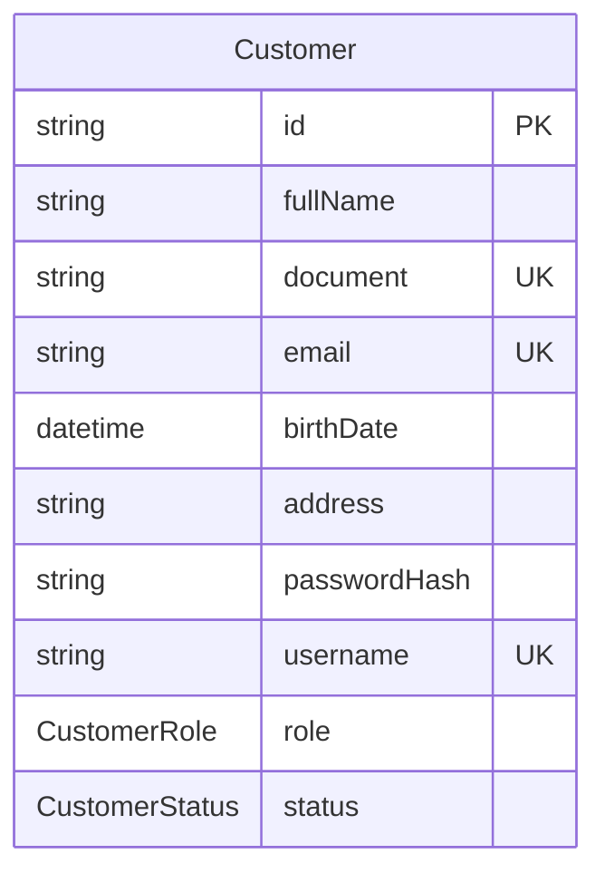
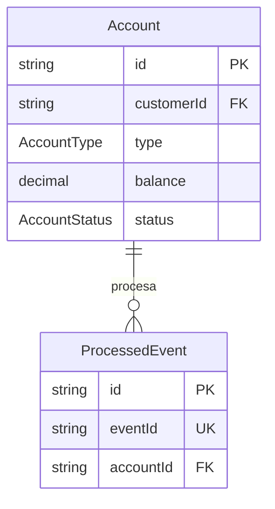
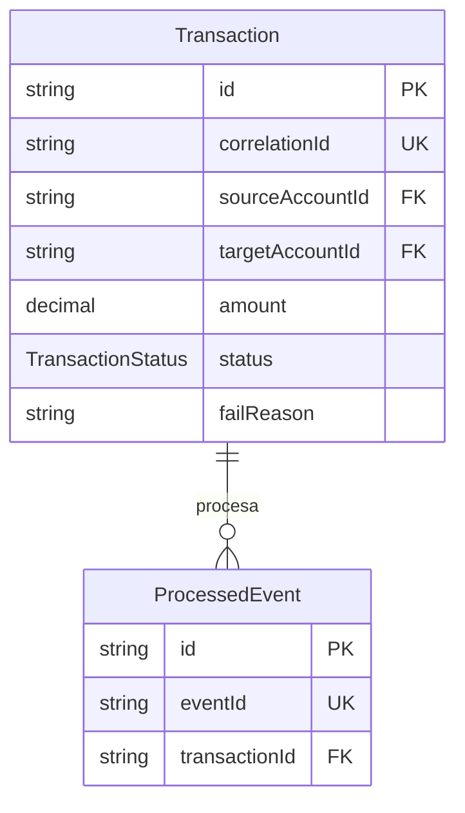
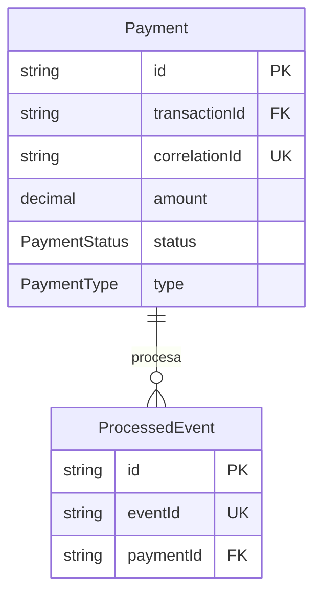
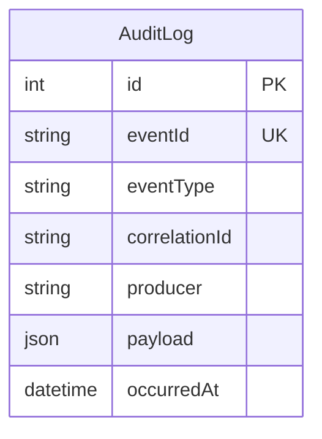

# Modelo de dominio

## Entidades y estados

| Entidad | Responsabilidad | Estados |
| --- | --- | --- |
| Cliente | Información, credenciales y ciclo de vida del cliente. | `ACTIVE`, `INACTIVE`, `BLOCKED` |
| Cuenta | Cuenta monetaria o de ahorro, saldo y fondos reservados. | `ACTIVE`, `INACTIVE`, `BLOCKED` |
| Transferencia | Operación entre cuenta origen y destino. | `PENDING`, `PROCESSING`, `COMPLETED`, `FAILED`, `COMPENSATING` |
| Pago | Solicitud y resultado de un pago. | `PENDING`, `PROCESSING`, `APPROVED`, `REJECTED` |
| Auditoría | Registro de eventos y operaciones relevantes. | No aplica |

## Reglas de negocio

| ID | Regla |
| --- | --- |
| RN-01 | El documento y el correo deben ser únicos. |
| RN-02 | El username debe ser único. |
| RN-03 | Solo un usuario activo puede recibir un JWT operativo. |
| RN-05 | Una cuenta pertenece exclusivamente a un cliente. |
| RN-06 | Una cuenta debe ser monetaria o de ahorro. |
| RN-07 | Una cuenta bloqueada o inactiva no puede originar transferencias. |
| RN-08 | El monto de una operación debe ser mayor que cero. |
| RN-09 | Una cuenta no puede transferirse dinero a sí misma. |
| RN-10 | El saldo disponible debe cubrir el monto solicitado. |
| RN-11 | Los fondos reservados no forman parte del saldo disponible. |
| RN-12 | Una solicitud repetida con la misma clave de idempotencia no genera otra operación. |
| RN-16 | Una cuenta se desactiva tras seis meses sin actividad y saldo menor a Q50.00. |

## Diagramas Entidad-Relación (ER) por Microservicio

A continuación se presentan los diagramas de Entidad-Relación para las bases de datos independientes de cada microservicio.

### Customer Service

### Account Service

### Transaction Service

### Payment Service

### Notification & Audit Service

