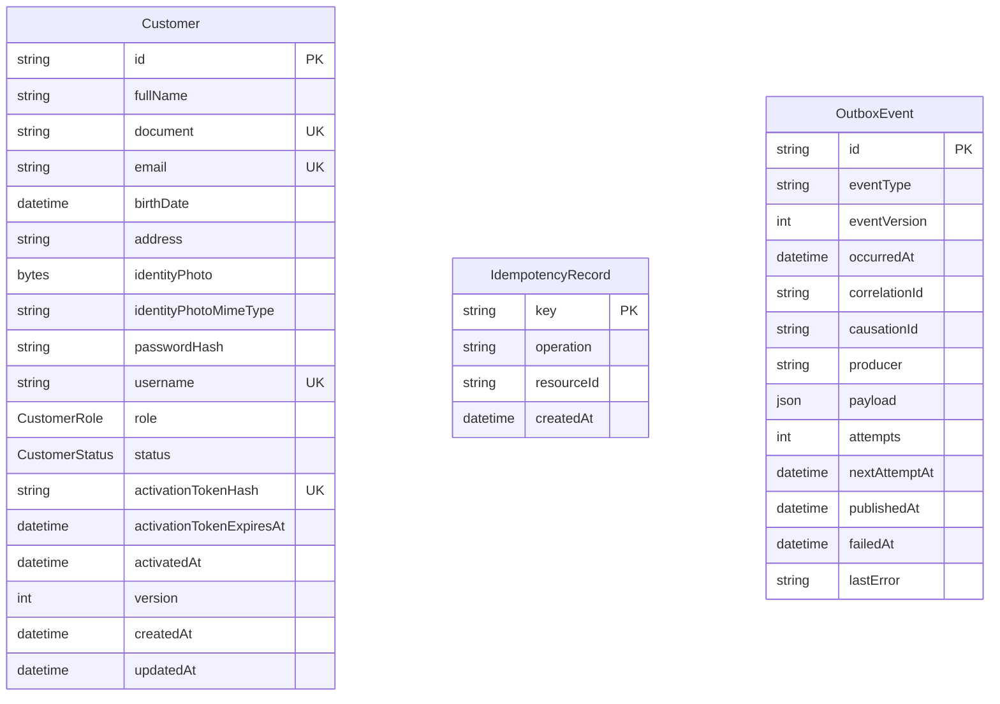
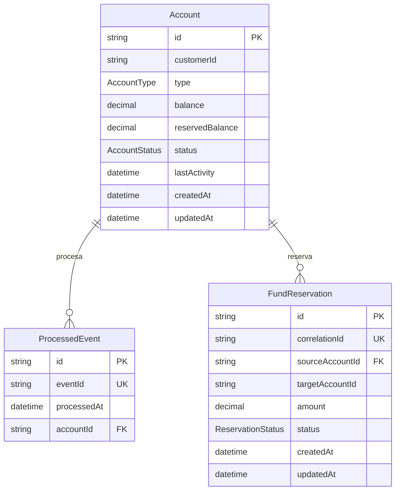
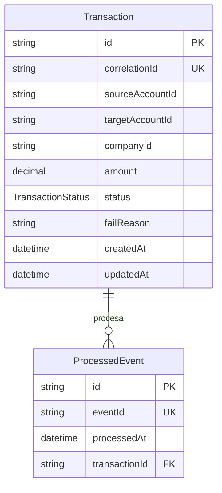
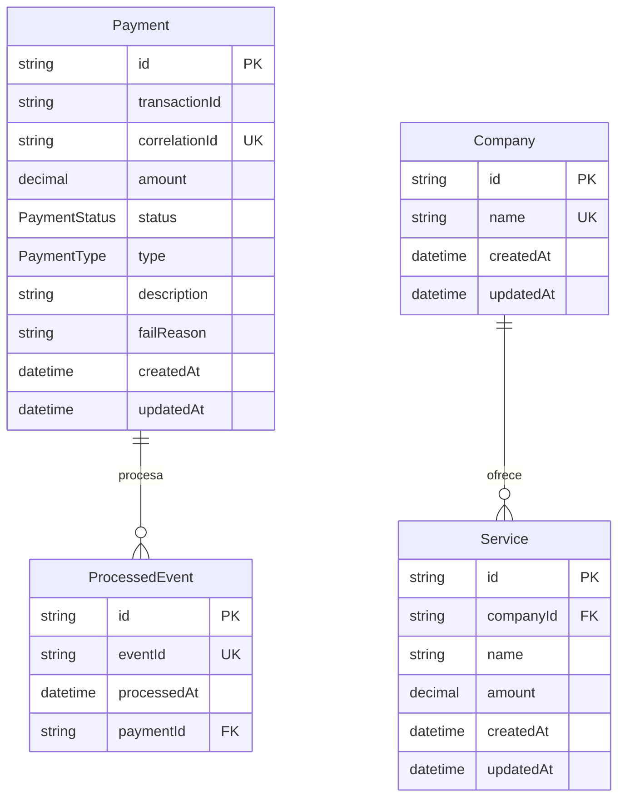
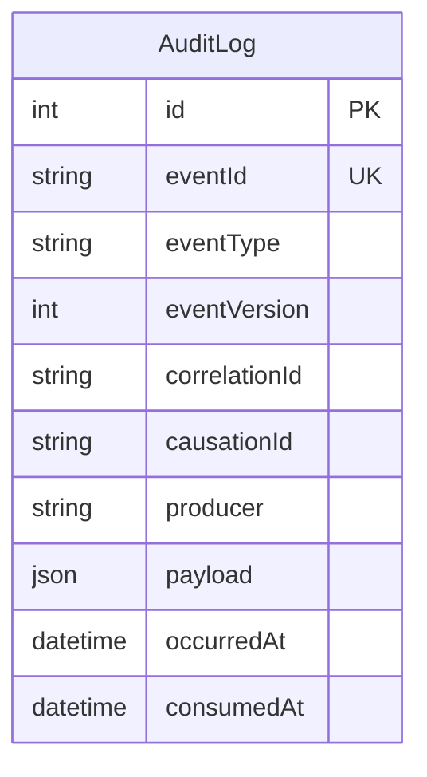

# Modelo de dominio

## Entidades y estados

| Entidad | Responsabilidad | Estados |
| --- | --- | --- |
| Cliente | Información, credenciales y ciclo de vida del cliente. | `ACTIVE`, `INACTIVE`, `BLOCKED` |
| Cuenta | Cuenta monetaria o de ahorro, saldo y fondos reservados. | `ACTIVE`, `INACTIVE`, `BLOCKED` |
| Transferencia | Operación entre cuenta origen y destino. | `PENDING`, `PROCESSING`, `COMPLETED`, `FAILED`, `COMPENSATING` |
| Pago | Solicitud y resultado de un pago. | `PENDING`, `PROCESSING`, `APPROVED`, `REJECTED` |
| Auditoría | Registro de eventos y operaciones relevantes. | No aplica |

## Reglas de negocio

| ID | Regla |
| --- | --- |
| RN-01 | El documento y el correo deben ser únicos. |
| RN-02 | El username debe ser único. |
| RN-03 | Solo un usuario activo puede recibir un JWT operativo. |
| RN-05 | Una cuenta pertenece exclusivamente a un cliente. |
| RN-06 | Una cuenta debe ser monetaria o de ahorro. |
| RN-07 | Una cuenta bloqueada o inactiva no puede originar transferencias. |
| RN-08 | El monto de una operación debe ser mayor que cero. |
| RN-09 | Una cuenta no puede transferirse dinero a sí misma. |
| RN-10 | `balance` representa el saldo disponible y debe cubrir el monto solicitado. |
| RN-11 | Al reservar, el monto se mueve de `balance` a `reservedBalance`; al confirmar se consume la reserva y al fallar se devuelve a `balance`. |
| RN-12 | Una solicitud repetida con la misma clave de idempotencia no genera otra operación. |
| RN-16 | Una cuenta se desactiva tras seis meses sin actividad y saldo menor a Q50.00. |

## Diagramas Entidad-Relación (ER) por Microservicio

A continuación se presentan los diagramas de Entidad-Relación para las bases de datos independientes de cada microservicio.

### Customer Service

`Customer`, `IdempotencyRecord` y `OutboxEvent` no tienen claves foráneas entre sí.

### Account Service

`Account.customerId` es una referencia lógica a `Customer` en Customer Service; no existe una clave foránea entre bases de datos. `FundReservation.targetAccountId` es una referencia logica porque puede ser nulo para pagos de servicios.

### Transaction Service

`Transaction.sourceAccountId` y `Transaction.targetAccountId` son referencias lógicas a `Account` en Account Service. `Transaction.companyId` es una referencia lógica al UUID de `Company` en Payment Service. No existen claves foráneas entre bases de datos.

### Payment Service

`Payment.transactionId` es una referencia lógica a `Transaction` en Transaction Service; no existe una clave foránea entre bases de datos. `Company.id` es el UUID referenciado por `Transaction.companyId` para las transacciones de servicios externos.

### Notification & Audit Service

`AuditLog` no tiene claves foráneas. Sus identificadores de correlación y causalidad vinculan eventos entre servicios a nivel de mensajería.
