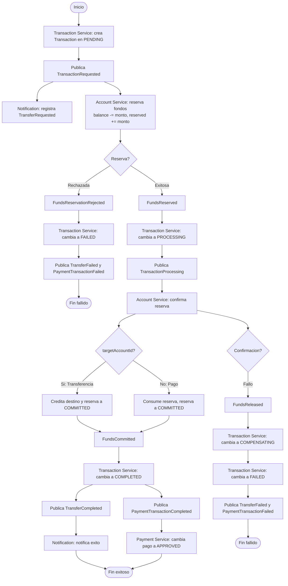
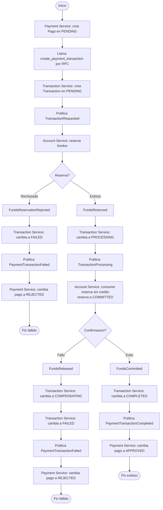

# Saga coreografiada de transacciones

La transferencia y el pago de servicios usan una Saga coreografiada. Cada servicio modifica unicamente sus propios datos y publica un evento; el siguiente participante reacciona a ese evento. No se utilizan los comandos anteriores `ReserveFunds`, `CreditDestination` ni `ReleaseFunds`.

## Saldos y reservas

Account Service mantiene dos saldos por cuenta:

- `balance`: saldo disponible para nuevas operaciones.
- `reservedBalance`: saldo retenido por transacciones pendientes.

Cada reserva se registra en `FundReservation` y se identifica por el `correlationId` de la Saga. Sus estados son `RESERVED`, `COMMITTED` y `RELEASED`.

| Operacion              |            `balance` | `reservedBalance` |
| ---------------------- | -------------------: | ----------------: |
| Reservar Q100          |                -Q100 |             +Q100 |
| Confirmar la operacion | Sin cambio adicional |             -Q100 |
| Liberar por fallo      |                +Q100 |             -Q100 |

La reserva usa una actualizacion condicional sobre el saldo disponible. Esto evita que dos operaciones concurrentes reserven los mismos fondos.

## Transferencia exitosa

1. Transaction Service crea la transaccion en `PENDING` y publica `TransactionRequested` en `account_queue`.
2. Account Service consume `TransactionRequested`, mueve el monto de `balance` a `reservedBalance`, crea `FundReservation(RESERVED)` y publica `FundsReserved` en `transaction_queue`.
3. Transaction Service consume `FundsReserved`, cambia la transaccion a `PROCESSING` y publica `TransactionProcessing` en `account_queue`.
4. Account Service consume `TransactionProcessing` y, dentro de una transaccion de base de datos, acredita la cuenta destino, descuenta el monto de `reservedBalance` y cambia la reserva a `COMMITTED`.
5. Account Service publica `FundsCommitted` en `transaction_queue`.
6. Transaction Service consume `FundsCommitted`, cambia la transaccion a `COMPLETED` y publica `TransferCompleted` en `notification_queue`.

## Compensacion

- Si la cuenta origen no existe, no esta activa o no tiene saldo disponible, Account Service no crea una reserva y publica `FundsReservationRejected`. Transaction Service cambia la transaccion a `FAILED`.
- Si el destino no existe, no esta activo o falla la confirmacion, Account Service cambia la reserva a `RELEASED`, devuelve el monto de `reservedBalance` a `balance` y publica `FundsReleased`. Transaction Service cambia la transaccion a `FAILED`.
- Una reserva `COMMITTED` no puede liberarse y una reserva `RELEASED` no puede confirmarse.

## Pago de servicios

El pago utiliza la misma coreografia, pero la transaccion tiene `companyId` y no tiene `targetAccountId`.

1. Payment Service crea el pago en `PENDING` y solicita la creacion de la transaccion mediante `create_payment_transaction`.
2. Transaction Service publica `TransactionRequested` y se reserva el saldo de la cuenta origen.
3. Al procesar `TransactionProcessing`, Account Service consume la reserva sin acreditar una cuenta destino y publica `FundsCommitted`.
4. Transaction Service cambia la transaccion a `COMPLETED` y publica `PaymentTransactionCompleted` en `payment_queue`.
5. Payment Service cambia el pago a `APPROVED`.

Si la reserva es rechazada o liberada, Transaction Service publica `PaymentTransactionFailed` y Payment Service cambia el pago a `REJECTED`.

## Diagrama de flujo: Saga coreografiada

### Transferencia bancaria

### Pagos de servicios

Los servicios se comunican unicamente por eventos en RabbitMQ. Cada servicio modifica sus propios datos y publica un evento; el siguiente participante reacciona sin que exista un orquestador central.

- `FundReservation.correlationId` es unico y evita reservar dos veces para una misma Saga.
- Account, Transaction y Payment Service registran los `eventId` procesados.
- Los eventos de cada etapa usan identificadores deterministas basados en `correlationId`, por ejemplo `correlationId:funds-reserved`.
- Transaction Service solo permite `PENDING -> PROCESSING` y `PROCESSING -> COMPLETED`; un evento tardio no modifica una transaccion terminal.
