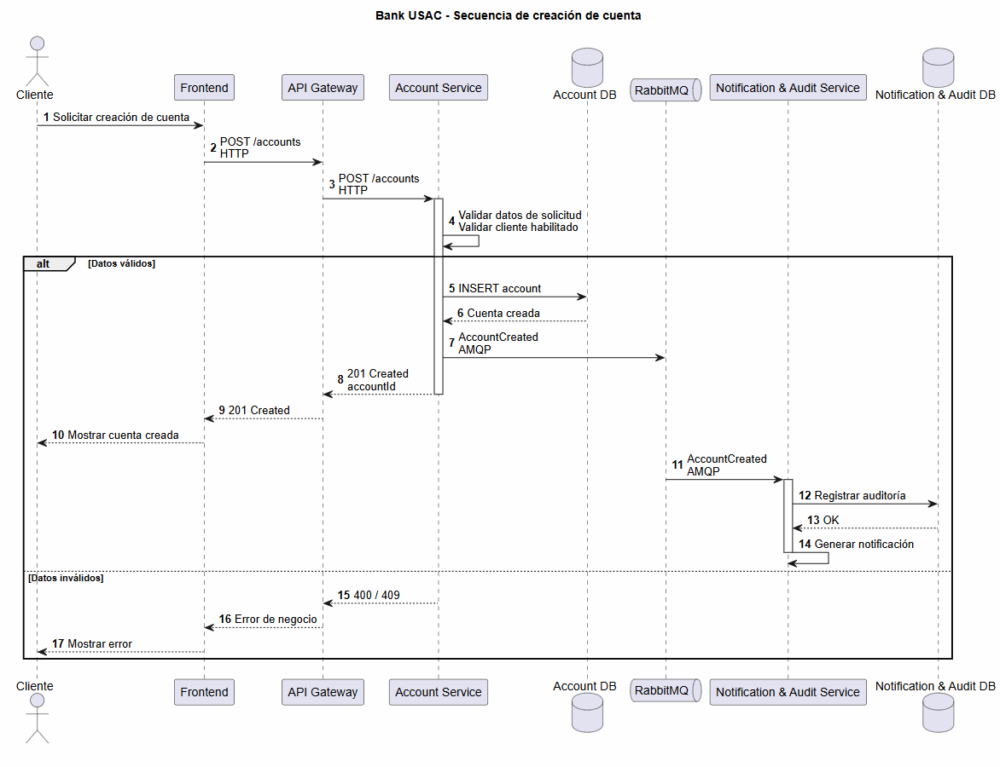

# Diagrama de secuencia - Creación de cuenta

La creación de una cuenta es responsabilidad de Account Service. La cuenta queda asociada al cliente mediante `customerId` y el servicio publica los eventos correspondientes para notificación y auditoría.
