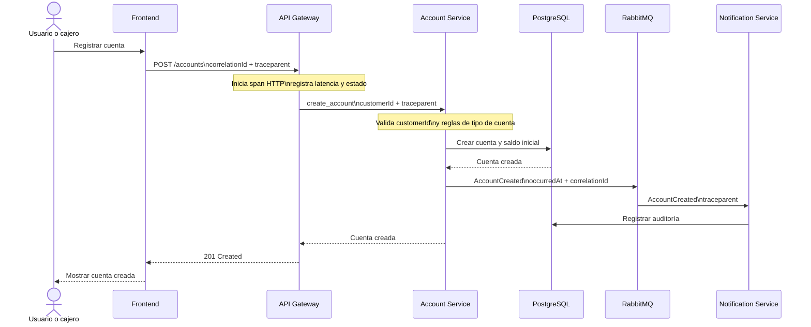

# Diagrama de secuencia - Creación de cuenta

La creación de una cuenta es responsabilidad de Account Service. La cuenta queda asociada al cliente mediante `customerId` y el servicio publica los eventos correspondientes para notificación y auditoría.

La operación conserva `correlationId` y `traceparent` desde API Gateway hasta
Account Service. La latencia HTTP, el resultado de la operación y la publicación
del evento quedan disponibles para observabilidad.

La imagen es una exportación estática; el bloque Mermaid anterior es la fuente
editable del diagrama.
