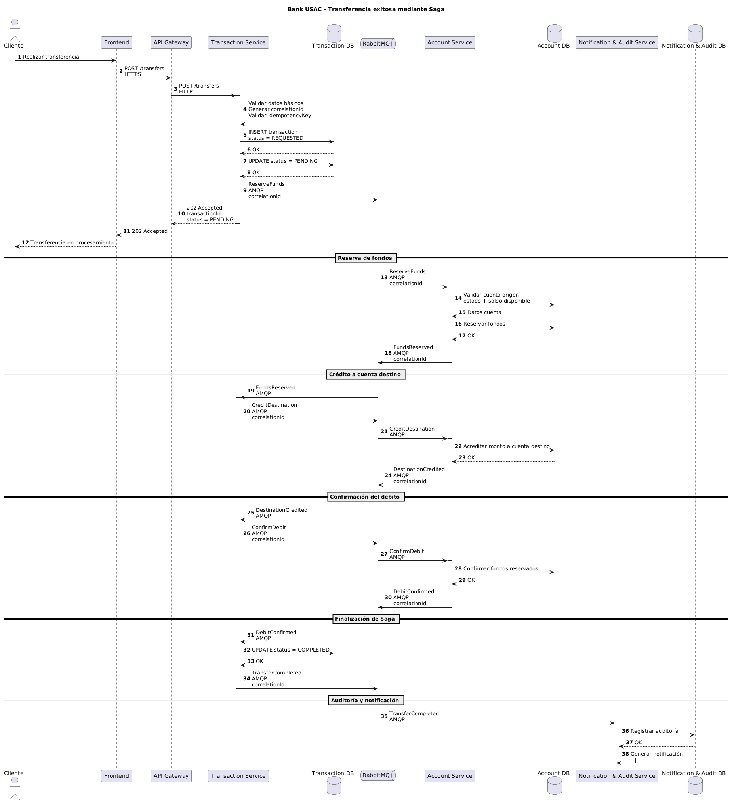
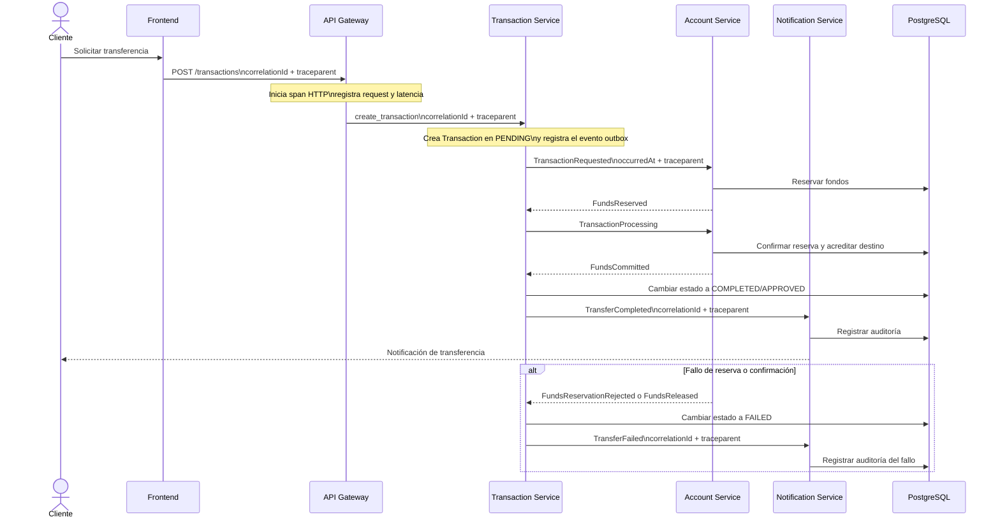

# Diagrama de secuencia - Transferencia

Transaction Service coordina la transferencia mediante una Saga: reserva fondos, acredita la cuenta destino y confirma el débito. Cada mensaje conserva el mismo `correlationId`.

La solicitud HTTP inicia una traza técnica en API Gateway. El `correlationId`
identifica la operación de negocio y `traceparent` continúa la traza a través de
RabbitMQ. Los eventos incluyen `occurredAt` para medir el tiempo de consumo.

La imagen es una exportación estática; el bloque Mermaid anterior es la fuente
editable del diagrama.
