# Casos de uso

## Casos de uso de alto nivel

El siguiente diagrama muestra los casos de uso principales de Bank USAC y sus actores.

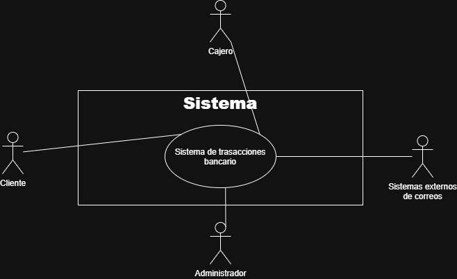

| Código | Caso de uso | Servicio responsable | Actores principales |
| --- | --- | --- | --- |
| CDU001 | Gestión de clientes y acceso | Customer Service | Cliente, Cajero/Receptor, Administrador |
| CDU002 | Gestión de cuentas y saldo | Account Service | Cliente, Cajero/Receptor, Administrador |
| CDU003 | Gestión de transferencias | Transaction Service | Cliente, Cajero/Receptor |
| CDU004 | Gestión de pagos | Payment Service | Cliente, Cajero/Receptor |
| CDU005 | Gestión de notificaciones y registros | Notification & Audit Service | Cliente, Administrador |

## Descomposición por servicio

### Customer Service

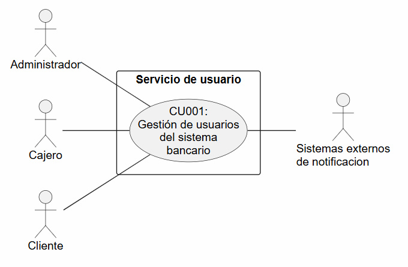

#### CDU001 - Gestión de clientes y acceso

| Campo | Descripción |
| --- | --- |
| **Nombre** | Gestión de clientes y acceso |
| **Código** | CDU001 |
| **Actores** | Cliente, Cajero/Receptor, Administrador |
| **Descripción** | Centraliza el registro, la identificación, las credenciales y el ciclo de vida de los clientes de Bank USAC. Permite registrar clientes y cajeros, iniciar sesión, activar cuentas y actualizar información de perfil. |
| **Precondiciones** | El sistema se encuentra operativo. El cajero/receptor o administrador ha iniciado sesión para realizar operaciones administrativas. El cliente proporciona datos personales y documento de identificación válidos. |
| **Postcondiciones** | El cliente o cajero queda registrado con sus credenciales y estado correspondiente. Cuando la activación es exitosa, el cliente queda habilitado para utilizar la plataforma. |
| **Flujo principal** | Ver diagrama de flujo principal. |
| **Flujos alternos** | Ver diagramas FA1 a FA5. |
| **Reglas de negocio** | RN1: El documento y el correo deben ser únicos.<br>RN2: El username debe ser único.<br>RN3: Solo un usuario activo puede recibir un JWT operativo.<br>RN4: El enlace de activación expira y solo puede utilizarse una vez. |
| **Reglas de calidad** | RC1: El registro debe validar los campos obligatorios antes de persistir la información.<br>RC2: Las credenciales deben protegerse y la autenticación debe emitir JWT solo para usuarios activos.<br>RC3: La activación debe usar un token temporal de un solo uso. |

##### Flujo principal

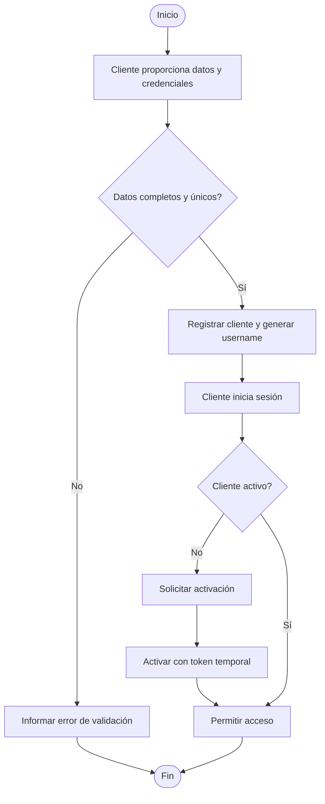

##### FA1 - Registrar cliente (CDU001.1)

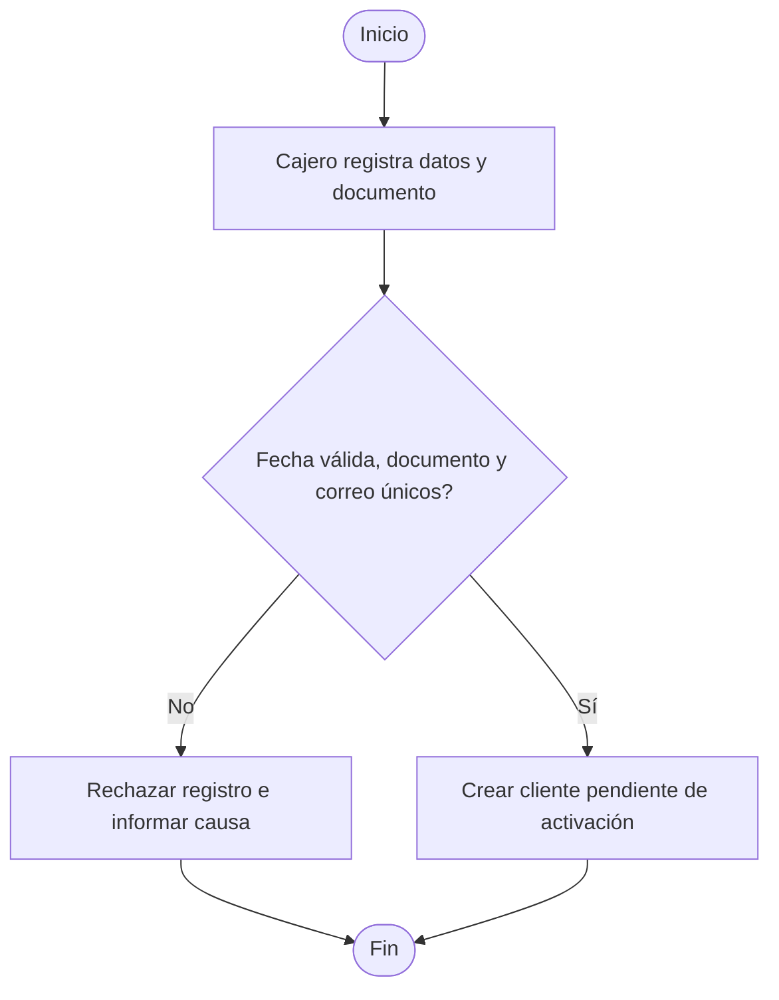

##### FA2 - Validar identidad (CDU001.2)

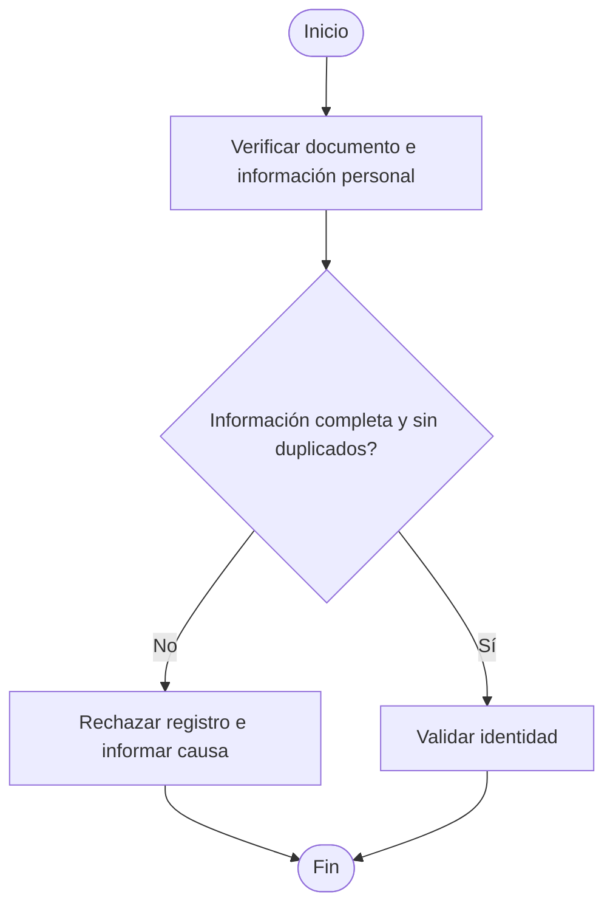

##### FA3 - Registrar cajero/receptor (CDU001.3)

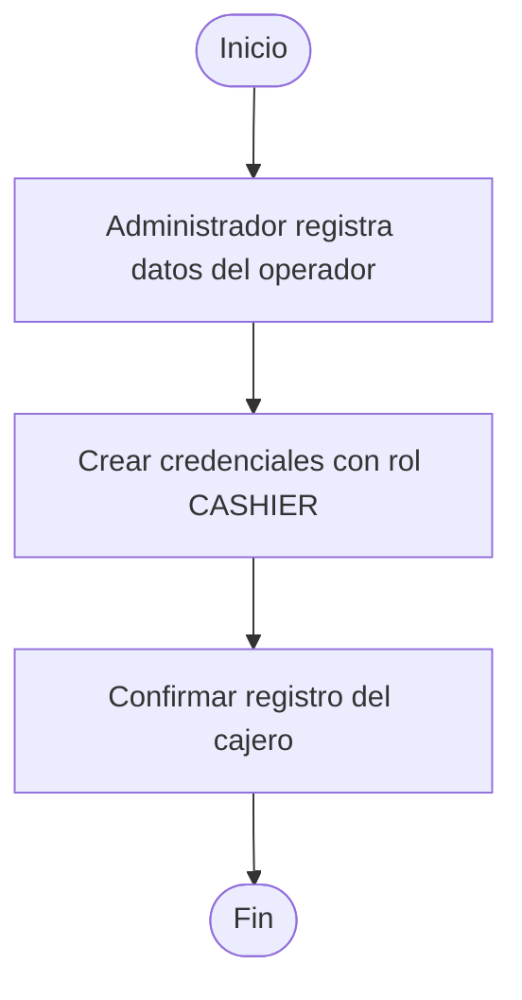

##### FA4 - Iniciar sesión y activar cuenta (CDU001.4 y CDU001.5)

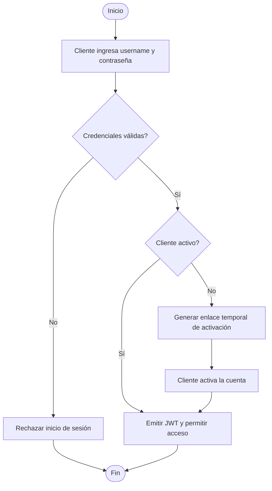

##### FA5 - Editar perfil (CDU001.7)

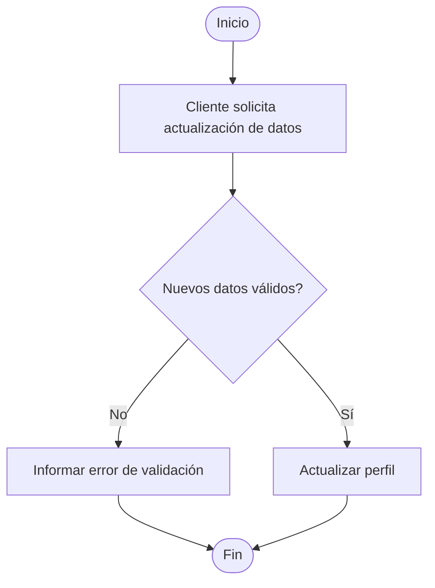

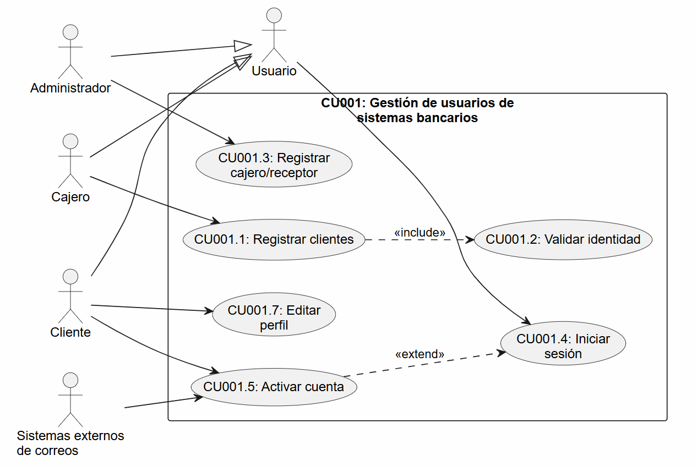

### Account Service

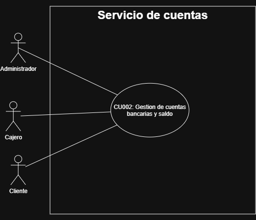

#### CDU002 - Gestión de cuentas bancarias y saldo

| Campo | Descripción |
| --- | --- |
| **Nombre** | Gestión de cuentas bancarias y saldo |
| **Código** | CDU002 |
| **Actores** | Cliente, Cajero/Receptor, Administrador |
| **Descripción** | Administra las cuentas monetarias y de ahorro, sus saldos, estados, movimientos de débito o crédito y reservas de fondos requeridas por transferencias. |
| **Precondiciones** | El cliente existe y se encuentra habilitado. El actor cuenta con permisos para crear, consultar, bloquear o modificar la cuenta. |
| **Postcondiciones** | La cuenta queda creada, consultada, bloqueada o actualizada según la operación solicitada. Los fondos reservados se mantienen separados del saldo disponible. |
| **Flujo principal** | Ver diagrama de flujo principal. |
| **Flujos alternos** | Ver diagramas FA1 a FA4. |
| **Reglas de negocio** | RN1: Una cuenta pertenece exclusivamente a un cliente.<br>RN2: Una cuenta debe ser monetaria o de ahorro.<br>RN3: Una cuenta `BLOCKED` o `INACTIVE` no puede originar transferencias.<br>RN4: Los fondos reservados no forman parte del saldo disponible.<br>RN5: Una cuenta se desactiva después de seis meses sin actividad y saldo menor a Q50.00. |
| **Reglas de calidad** | RC1: Cada cuenta debe conservar su saldo y estado de forma consistente.<br>RC2: Las operaciones de reserva, crédito y liberación deben poder identificarse para evitar duplicados.<br>RC3: La consulta de saldo solo debe mostrar información de cuentas autorizadas. |

##### Flujo principal

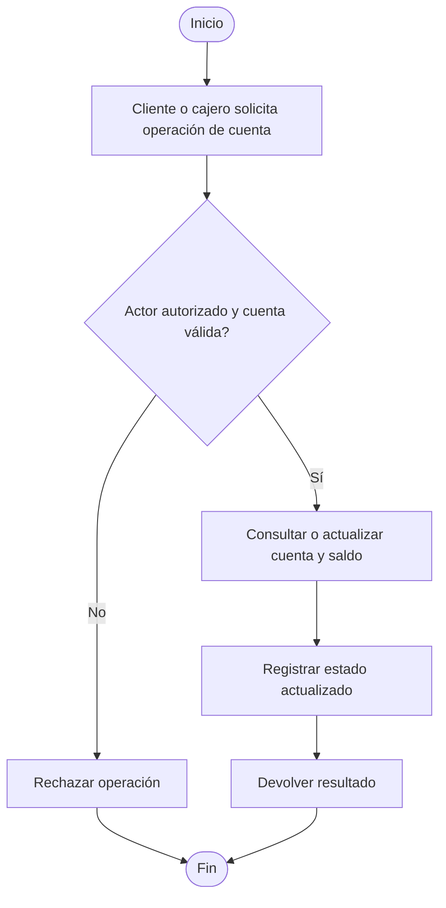

##### FA1 - Crear cuenta (CDU002.1)

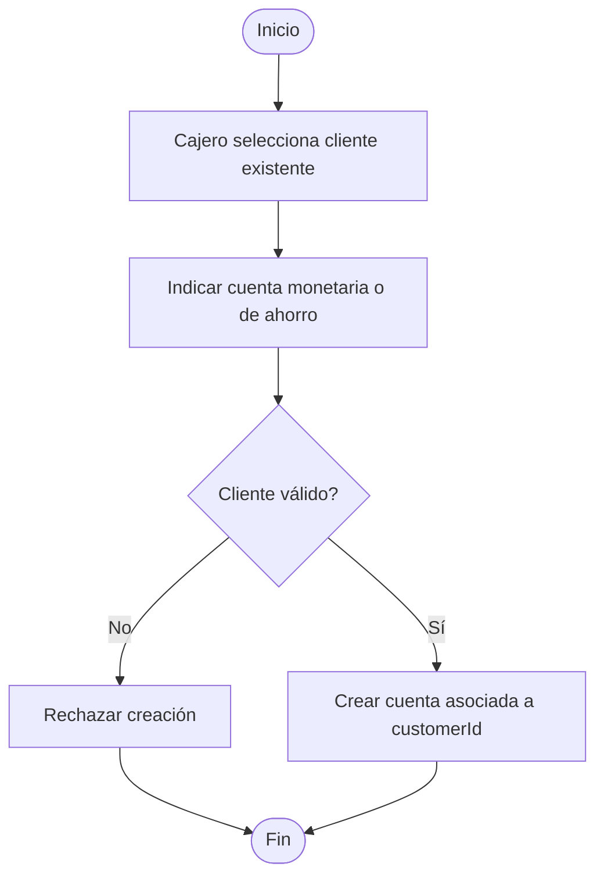

##### FA2 - Consultar saldo o cuenta (CDU002.2 y CDU002.3)

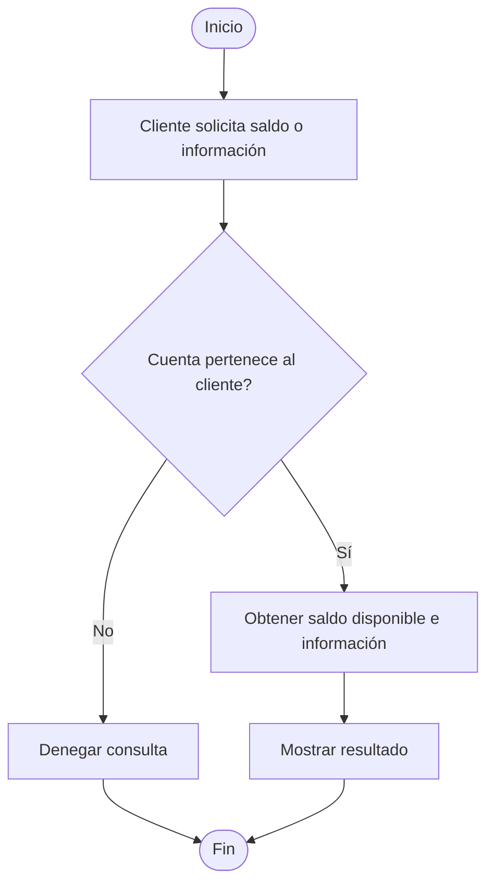

##### FA3 - Bloquear cuenta (CDU002.4)

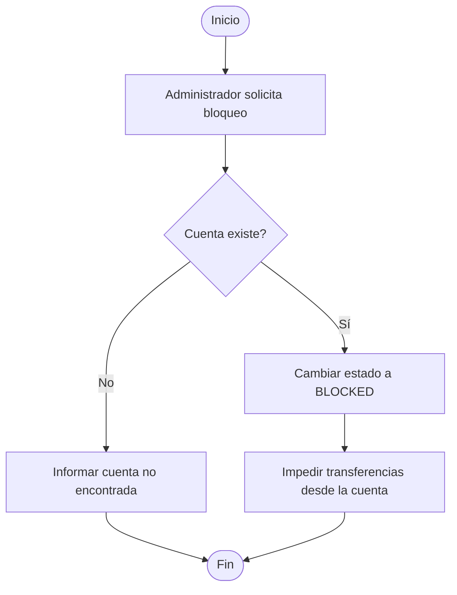

##### FA4 - Actualizar saldo y compensar (CDU002.5 y CDU002.6)

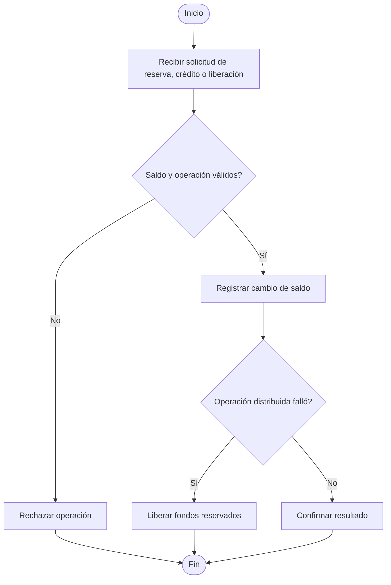

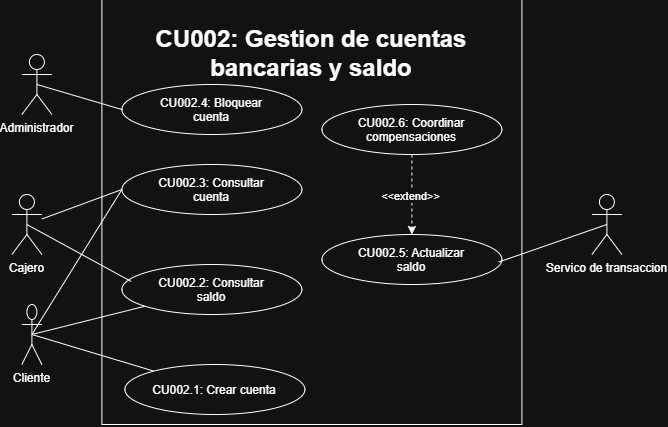

### Transaction Service

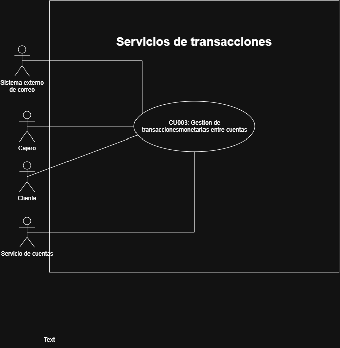

#### CDU003 - Gestión de transferencias monetarias

| Campo | Descripción |
| --- | --- |
| **Nombre** | Gestión de transferencias monetarias entre cuentas |
| **Código** | CDU003 |
| **Actores** | Cliente, Cajero/Receptor |
| **Descripción** | Permite iniciar transferencias entre cuentas, validar la información financiera, mantener el estado de la operación y consultar el historial de transferencias. |
| **Precondiciones** | El cliente se encuentra autenticado y posee una cuenta origen activa. La cuenta origen y destino existen. El monto solicitado es mayor que cero. |
| **Postcondiciones** | La transferencia queda registrada con su estado actual. Si se completa, los fondos quedan acreditados en la cuenta destino; si falla, se liberan los fondos reservados cuando aplica. |
| **Flujo principal** | Ver diagrama de flujo principal. |
| **Flujos alternos** | Ver diagramas FA1 a FA4. |
| **Reglas de negocio** | RN1: La cuenta origen debe pertenecer al cliente autenticado.<br>RN2: No se permite transferir dinero a la misma cuenta.<br>RN3: El monto debe ser mayor que cero.<br>RN4: El saldo disponible debe cubrir el monto solicitado.<br>RN5: Una solicitud repetida no debe crear una nueva transferencia. |
| **Reglas de calidad** | RC1: Los mensajes de una transferencia deben conservar el mismo `correlationId`.<br>RC2: El procesamiento debe evitar operaciones duplicadas.<br>RC3: Ante fallo posterior a una reserva, el sistema debe liberar los fondos reservados. |

##### Flujo principal

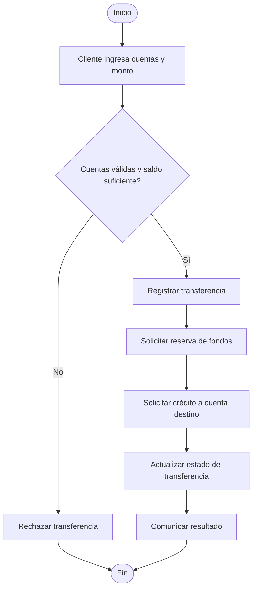

##### FA1 - Iniciar transferencia (CDU003.1)

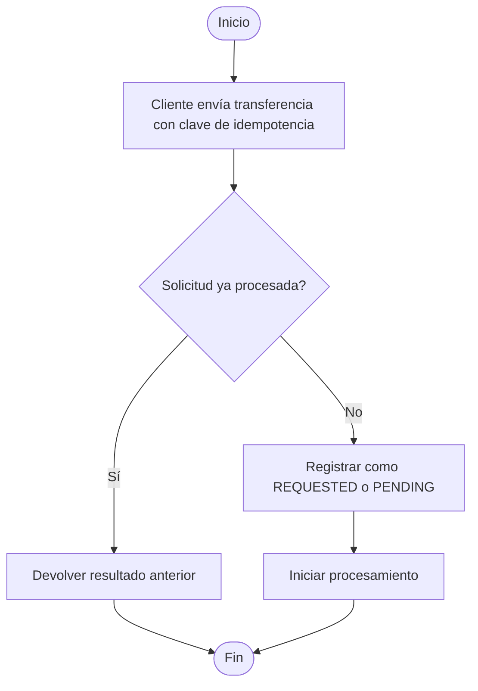

##### FA2 - Validar información (CDU003.2)

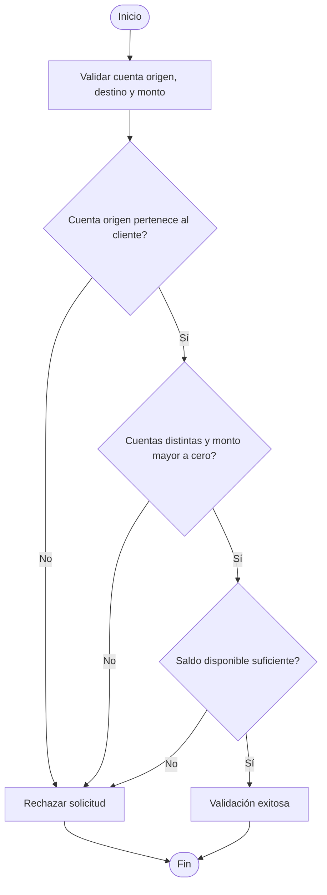

##### FA3 - Gestionar estado (CDU003.3)

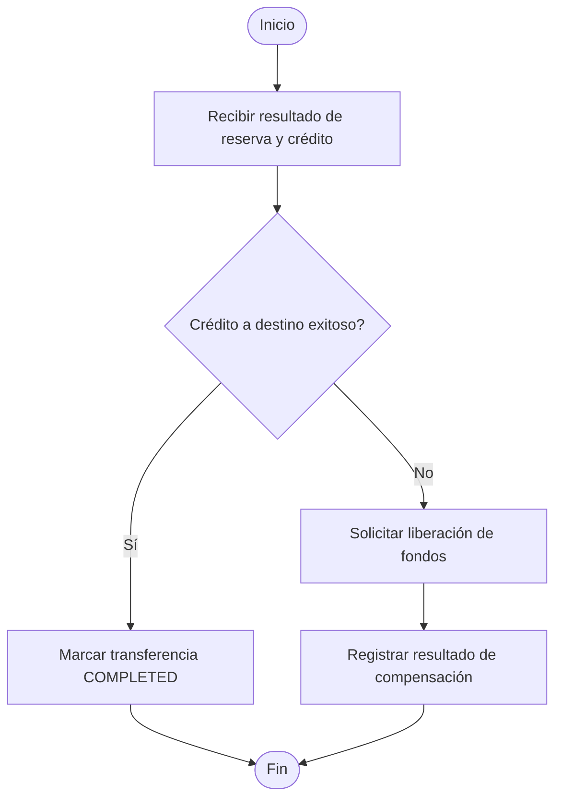

##### FA4 - Consultar transferencias (CDU003.4)

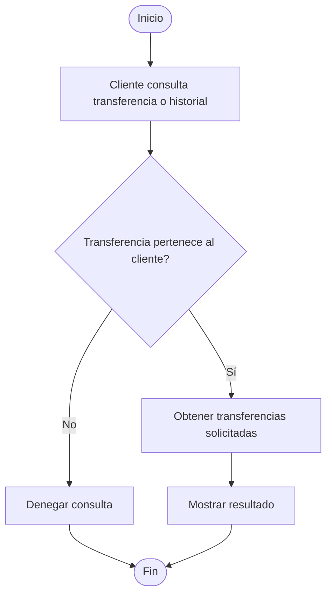

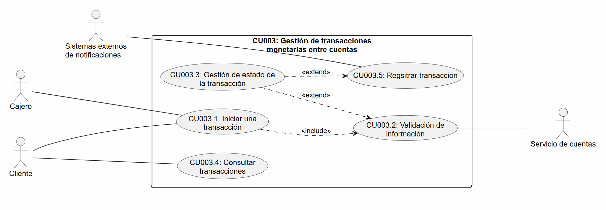

### Payment Service

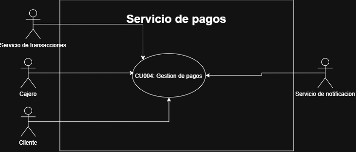

#### CDU004 - Gestión de pagos

| Campo | Descripción |
| --- | --- |
| **Nombre** | Gestión de pagos |
| **Código** | CDU004 |
| **Actores** | Cliente, Cajero/Receptor |
| **Descripción** | Permite registrar pagos asociados a operaciones, validar su información, procesarlos y consultar su estado o historial. |
| **Precondiciones** | El cliente se encuentra autenticado. La información del pago está completa y la operación relacionada existe cuando aplica. |
| **Postcondiciones** | El pago queda registrado con estado `APPROVED`, `REJECTED` o `FAILED`, según el resultado de su procesamiento. |
| **Flujo principal** | Ver diagrama de flujo principal. |
| **Flujos alternos** | Ver diagramas FA1 a FA4. |
| **Reglas de negocio** | RN1: Un pago debe estar asociado a una operación válida cuando corresponda.<br>RN2: Un mismo pago no debe procesarse dos veces.<br>RN3: Todo rechazo debe conservar su causa.<br>RN4: Solo un pago pendiente puede cancelarse. |
| **Reglas de calidad** | RC1: El estado del pago debe estar disponible para consulta después de su procesamiento.<br>RC2: El procesamiento debe evitar duplicados.<br>RC3: Los resultados aprobados o rechazados deben notificarse al servicio correspondiente. |

##### Flujo principal

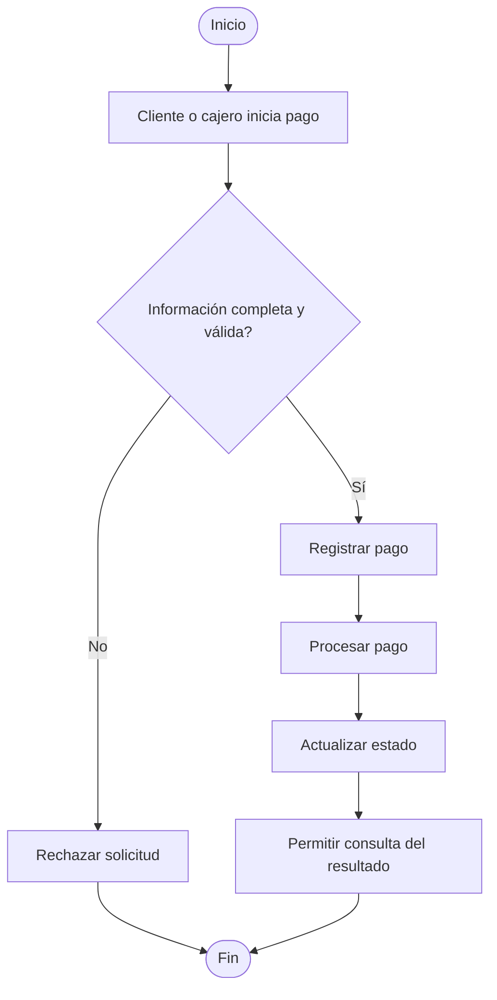

##### FA1 - Consultar historial de pagos (CDU004.1)

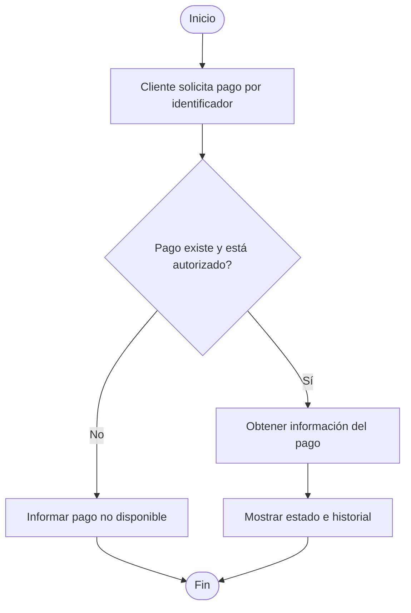

##### FA2 - Iniciar y validar pago (CDU004.2 y CDU004.3)

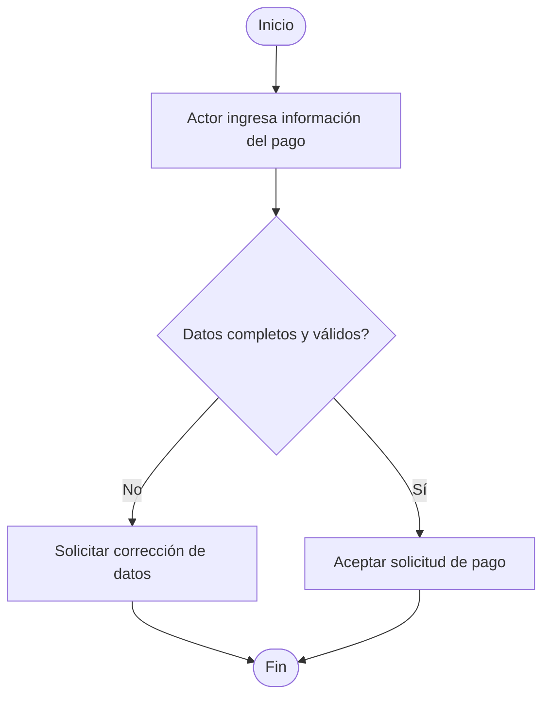

##### FA3 - Registrar pago (CDU004.4)

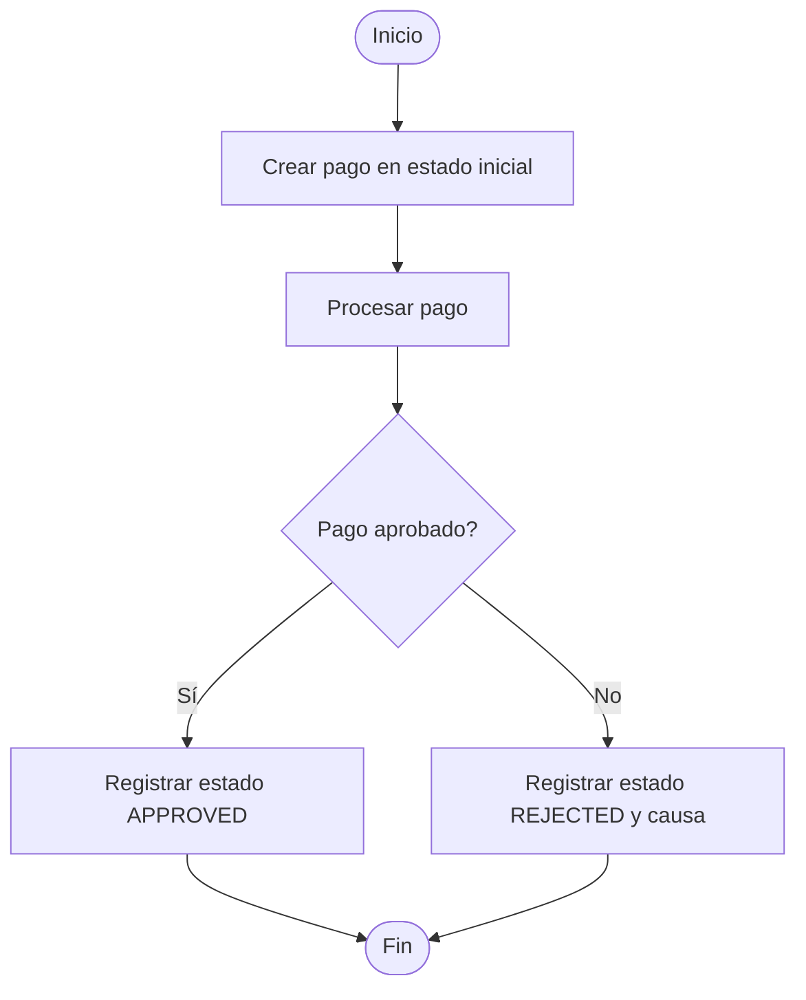

##### FA4 - Cancelar pago (CDU004.5)

```mermaid
flowchart TD
    A([Inicio]) --> B[Cliente solicita cancelación]
    B --> C{Pago pendiente?}
    C -->|No| D[Rechazar cancelación]
    C -->|Sí| E[Registrar cancelación]
    D --> Z([Fin])
    E --> Z
```

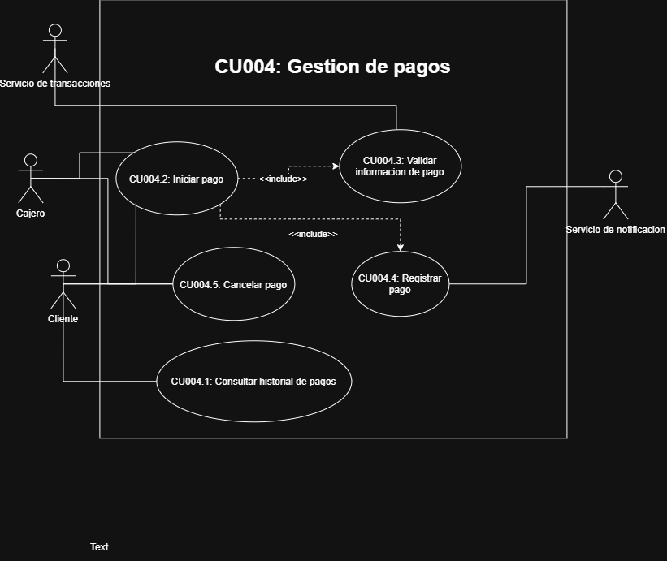

### Notification & Audit Service

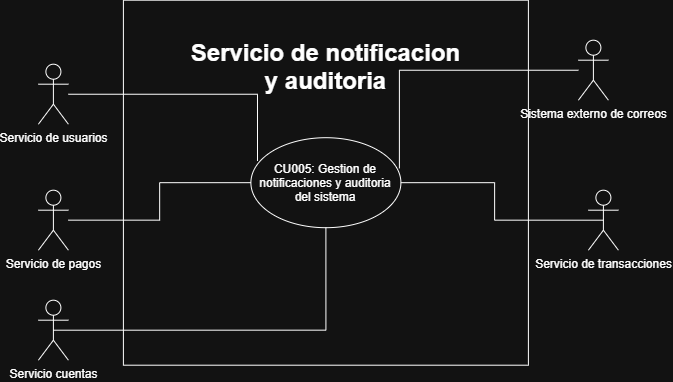

#### CDU005 - Gestión de notificaciones y registros internos


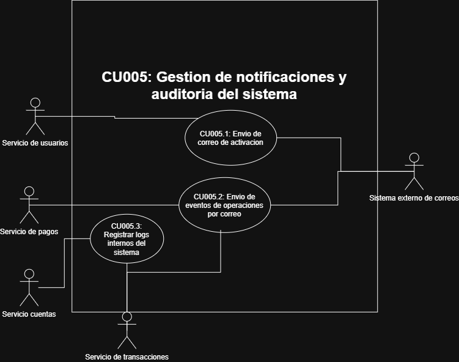
| Campo | Descripción |
| --- | --- |
| **Nombre** | Gestión de notificaciones y registros internos |
| **Código** | CDU005 |
| **Actores** | Cliente, Administrador |
| **Descripción** | Recibe eventos generados por los demás servicios para enviar notificaciones de activación, transferencias y pagos, además de conservar registros internos de las operaciones procesadas. |
| **Precondiciones** | Los servicios productores han publicado un evento con su información de correlación. El cliente cuenta con un correo registrado cuando la operación requiere notificación. |
| **Postcondiciones** | El evento queda registrado para consulta interna y el cliente recibe la notificación correspondiente cuando aplica. |
| **Flujo principal** | Ver diagrama de flujo principal. |
| **Flujos alternos** | Ver diagramas FA1 a FA3. |
| **Reglas de negocio** | RN1: Los eventos de una misma operación deben conservar el mismo `correlationId`.<br>RN2: Un fallo de notificación no revierte una transferencia o pago completado.<br>RN3: Un evento repetido no debe duplicar el registro interno. |
| **Reglas de calidad** | RC1: El procesamiento debe conservar la información necesaria para rastrear la operación.<br>RC2: Las notificaciones fallidas deben poder identificarse para su seguimiento.<br>RC3: El servicio debe procesar los eventos sin bloquear la operación bancaria original. |

##### Flujo principal

```mermaid
flowchart TD
    A([Inicio]) --> B[Servicio publica evento relevante]
    B --> C[Recibir y procesar evento]
    C --> D[Conservar información de la operación]
    D --> E{Evento requiere notificación?}
    E -->|Sí| F[Generar notificación al cliente]
    E -->|No| Z([Fin])
    F --> Z
```

##### FA1 - Enviar correo de activación (CDU005.1)

```mermaid
flowchart TD
    A([Inicio]) --> B[Recibir ActivationEmailRequested]
    B --> C{Cliente tiene correo registrado?}
    C -->|No| D[Registrar imposibilidad de notificar]
    C -->|Sí| E[Preparar notificación de activación]
    E --> F[Enviar correo]
    D --> Z([Fin])
    F --> Z
```

##### FA2 - Notificar operaciones (CDU005.2)

```mermaid
flowchart TD
    A([Inicio]) --> B[Recibir resultado de transferencia o pago]
    B --> C{Resultado requiere aviso al cliente?}
    C -->|No| D[Finalizar procesamiento]
    C -->|Sí| E[Preparar notificación de resultado]
    E --> F[Enviar notificación al cliente]
    D --> Z([Fin])
    F --> Z
```

##### FA3 - Registrar información interna (CDU005.3)

```mermaid
flowchart TD
    A([Inicio]) --> B[Recibir evento]
    B --> C[Conservar tipo, fecha, payload y correlationId]
    C --> D[Administrador consulta registros cuando es necesario]
    D --> Z([Fin])
```